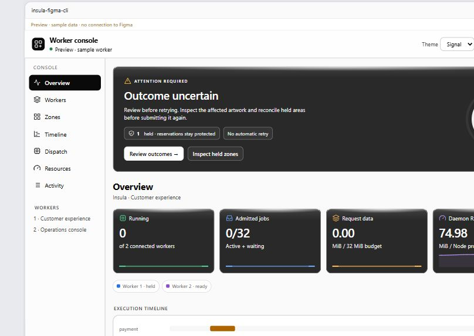
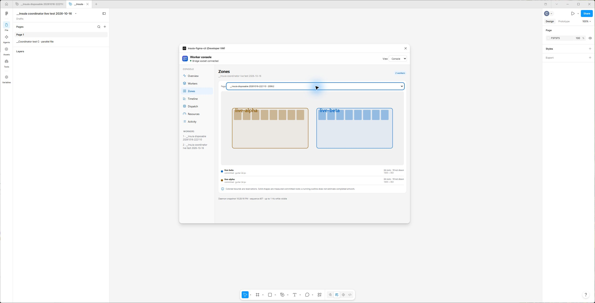
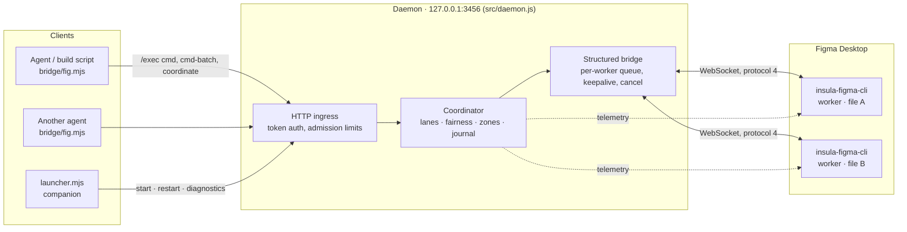

# figma-cli · Insula structured bridge

A fork of [silships/figma-cli](https://github.com/silships/figma-cli) v2.2.5 (upstream commit
`630a0dd`) that keeps Figma automation working on **Figma Desktop 126+**. It turns the single-connection
Safe Mode plugin into a **coordinated, multi-file worker system** with a live graphic console.

> The original project's README is preserved unchanged in **[README.md.old](README.md.old)**. It
> describes the stock CLI (Yolo/Browser/Safe modes, `render`, tokens, blocks, extract, motion, …).
> This document covers only what this fork adds or changes, and how to install and run it.

| | |
|---|---|
| Plugin name in Figma | **insula-figma-cli** (manifest id `insula-figma-cli-structured`) |
| Bridge protocol | **4** |
| Daemon | `127.0.0.1:3456`, plugin mode |
| State directory | `~/.insula-figma-cli` (token, PID, pairing, coordinator journal) |
| Platform tested | Windows 11, Figma Desktop 126.x, Node 24 |

---

## Contents

1. [Why this fork exists](#1-why-this-fork-exists)
2. [Stock vs. this fork at a glance](#2-stock-vs-this-fork-at-a-glance)
3. [Install and run](#3-install-and-run)
4. [Using the bridge](#4-using-the-bridge)
5. [The plugin UI: the worker console](#5-the-plugin-ui-the-worker-console)
6. [Architecture](#6-architecture)
7. [Protocol versions](#7-protocol-versions)
8. [The orchestrator (coordinator)](#8-the-orchestrator-coordinator)
9. [Concurrency and parallelism](#9-concurrency-and-parallelism)
10. [Reliability and the failure contract](#10-reliability-and-the-failure-contract)
11. [Memory management](#11-memory-management)
12. [Budgets and limits](#12-budgets-and-limits)
13. [Diagnostics](#13-diagnostics)
14. [Testing and measured evidence](#14-testing-and-measured-evidence)
15. [Known limits](#15-known-limits)
16. [What changed in the source](#16-what-changed-in-the-source)
17. [License and credits](#17-license-and-credits)

---

## 1. Why this fork exists

**Figma 126+ rejects `eval()` inside the plugin sandbox.** Stock Safe Mode sends JavaScript strings for
the plugin to evaluate, so on current Figma Desktop it cannot run anything. This fork replaces evaluated
code with **structured JSON commands** (`{ op: 'create', spec: … }`) that the plugin interprets itself.

A review of the stock bridge under real load (≈2,200 generated frames, 160k–200k nodes per 676 frames)
found a chain of problems behind the freezes and disconnects on long runs:

1. **False disconnects.** The UI keepalive closed the socket after 8 s without a pong. A busy Figma main
   thread looked like a dead connection.
2. **Everything in flight was rejected.** The daemon held exactly one plugin socket (`pluginWs`), and any
   close rejected every pending request, even ones belonging to another socket.
3. **Retries ran beside the original.** There was no queue and no cancellation, so a timed-out batch kept
   running while the client's retry started a second copy.
4. **The main thread starved.** There were no yields inside batches. `find` walked every node on the page,
   and every export copied the PNG several times.
5. **One connection only.** The single `pluginWs` was the hard blocker for any parallel work.

This fork fixes that chain first (protocol 2), then makes memory and lifecycle observable (protocol 3).
It then adds paired multi-file workers, page lanes, durable canvas reservations and a real-time console
(protocol 4).

## 2. Stock vs. this fork at a glance

| Area | Stock figma-cli 2.2.5 (Safe Mode) | This fork |
|---|---|---|
| Plugin execution | `eval()` of JS strings (blocked on Figma 126+) | Structured JSON ops interpreted in the plugin |
| Connections | One plugin socket; last connection wins | Up to **4 paired file workers**, one writer per file |
| Scheduling | None; requests race | FIFO per lane, fair round-robin across page lanes, files drain independently |
| Cancellation | None | Queued jobs dropped instantly; active jobs cancel at node boundaries and roll back owned nodes |
| Failure reporting | "Daemon unreachable" for everything | Typed errors (`kind`) and outcomes: `not-started`, `rolled-back`, `partial`, `failed`, `uncertain` |
| Keepalive | UI ping every 3 s, close after 8 s | The daemon owns the keepalive (15 s ping, 60 s silence); the UI never kills a busy worker |
| Canvas safety | None; frames could overlap existing art | Atomic zone reservations with gutters, collision/overflow checks, automatic placement |
| Recovery | None | Durable metadata journal; interrupted work is *held*, never replayed automatically |
| Security | Unauthenticated `/plugin` WebSocket | Token-authenticated daemon, explicit computer pairing, per-worker session epochs |
| Plugin UI | Small connection status window | **Worker console**: 3 sizes, 2 themes, 7 sections, live telemetry |
| State | Shared `~/.figma-ds-cli` | Dedicated `~/.insula-figma-cli` (no collisions with other figma-cli copies) |
| Startup | `figma-cli connect --safe` by hand | Launcher (`bridge/launcher.mjs`) plus an optional Windows sign-in companion |
| Memory | Hot-reloaded temp ES modules, all pages preloaded | Bounded queues and caches, operation-scoped fonts, no page preload, measured |

**Stock commands that do not work with this plugin:** `render`, `render-batch`, `eval`, `blocks`,
`shadcn`, `tokens` and anything else that relies on evaluated code. The daemon answers them with an
explanation. Everything goes through the structured bridge in [`bridge/`](bridge/).

---

## 3. Install and run

### Requirements

- Figma Desktop (tested on 126.x)
- Node.js 24 (`npm` included)
- Git
- Windows for the automatic companion. The launcher and daemon themselves are plain Node.

### 3.1 Clone and build

```bash
git clone https://github.com/camilogo1200/figma-cli-improvement.git figma-cli
cd figma-cli
npm ci
node bridge/launcher.mjs build
```

`build` fingerprints the runtime sources and stamps the plugin build ID into `plugin/code.js`. The daemon
and the plugin both refuse to work with a mismatched build.

### 3.2 Import the plugin into Figma (once per machine)

**Figma → Plugins → Development → Import plugin from manifest…** → select `plugin/manifest.json`.

The plugin appears as **insula-figma-cli**. The manifest enables the private Plugin API so the plugin can
attest the live file key. A file *name* or URL is never accepted as proof of identity.

### 3.3 Start the daemon

Either start it by hand:

```bash
node bridge/launcher.mjs start
```

or install the Windows companion. It starts at sign-in, checks every 5 s and starts the daemon when it is
absent:

```bash
node bridge/launcher.mjs companion-install
```

The companion owns a single `Insula Figma Companion.lnk` in the user's Startup folder. It refuses a
different checkout, a stale build or an inaccessible daemon, and it never kills Figma or replays work.
Keep the checkout at its installed path, or run `companion-uninstall` before moving it.

### 3.4 Pair the plugin

Open a design file and run **Plugins → Development → insula-figma-cli**. Keep its window open.

1. Choose **Connect this computer**.
2. Compare the confirmation number with the Windows dialog and choose **Yes**.

Later openings reuse the saved pairing, in any file. **Connection settings → Forget this computer**
revokes it. If the companion is unavailable, **Advanced pairing & setup** accepts a two-minute one-use
code from:

```bash
node bridge/launcher.mjs pair
```

### 3.5 Verify

```bash
node bridge/launcher.mjs diagnostics
node bridge/launcher.mjs ping
```

`diagnostics` must report `"matches": true`. `ping` must report `protocol: 4` and a version containing
`-insula-`.

### 3.6 After editing the source

1. Disable **Plugins → Development → Hot reload plugin**. A save with hot reload on can interrupt an
   active job.
2. Wait until all workers are idle.
3. Run `node bridge/launcher.mjs build`, then `node bridge/launcher.mjs restart`. The restart is guarded:
   it refuses active work and never kills a PID from a stale file.
4. Close the plugin window in each file and run it again.

### Launcher commands

| Command | Purpose |
|---|---|
| `build` | Stamp the plugin build ID |
| `start` / `stop` / `restart` | Guarded daemon lifecycle |
| `diagnostics` (or `status`) | Local vs. daemon build, state paths, Node, Figma process memory |
| `companion-install` / `companion-uninstall` | Windows sign-in companion |
| `migrate-state` | One-time move from the shared `~/.figma-ds-cli` state |
| *anything else* | Forwarded to `bridge/fig.mjs` (see below) |

---

## 4. Using the bridge

### 4.1 Terminal

```bash
node bridge/fig.mjs info                  # file, page, worker identity
node bridge/fig.mjs health
node bridge/fig.mjs workers               # coordinator status: workers, epochs, file keys
node bridge/fig.mjs lanes
node bridge/fig.mjs children "UI / "      # direct page children (optional name prefix), with duplicate report
node bridge/fig.mjs find "Button"
node bridge/fig.mjs tree <nodeId>
node bridge/fig.mjs export <nodeId> out.png
node bridge/fig.mjs cancel [requestId]
node bridge/fig.mjs send commands.json    # one command object or an array (= batch)
node bridge/fig.mjs layout layout.json    # automatic placement in a free area
node bridge/fig.mjs submit envelope.json  # explicit routing + zone reservation
```

`send` takes a **file path**, not inline JSON.

### 4.2 Operations

`ping`, `info`, `cancel`, `create`, `update`, `find`, `children`, `tree`, `remove`, `select`, `page`,
`audit`, `fonts`, `reactions`, `flowStart`, `image`, `exportImage`.

- **`create`** accepts `spec` or `specs`. Common fields: `type`, `name`, `children`, `layout: ROW|COL`,
  `w/h`, `wSize/hSize: FILL|HUG`, `gap`, `p/px/py/pt/pr/pb/pl`, `justify/items`, `fill/stroke`, `radius`,
  `text/font/weight/style/size/color`, `lineHeight`, `x/y`, `effects` (DROP_SHADOW, BACKGROUND_BLUR,
  LAYER_BLUR), `opacity`, `clip`. SVG: `{type:'SVG', svg, w}`. It also supports native `SECTION` nodes,
  component instances (`{type:'INSTANCE', of: componentId}`), dashed borders and arrowheads.
- **`image`** `{op:'image', base64}` returns a reusable image hash. Identical bytes reuse the same hash.
- **`page`** `{op:'page', action:'list'|'create'|'select'|'rename'|'update'}`. Use explicit page IDs as
  parents for page-specific builds.
- **`fonts`** `{op:'fonts', query}` lists families and styles. Weight keywords map to style names,
  including the `Semi Bold` / `SemiBold` / `Semibold` spellings.

### 4.3 Node scripts

```js
import { cmd, cmdBatch, coordinate, createLayout, health } from 'file:///C:/path/to/figma-cli/bridge/fig.mjs';

await cmd({ op: 'create', parent: pageId, spec, select: false }, 120000);
await cmdBatch(commands, 120000, { queueTimeoutMs: 30000, signal });
```

On Windows, import with a `file:///` URL. A bare `C:/…` specifier fails with
`ERR_UNSUPPORTED_ESM_URL_SCHEME`.

With **more than one file connected, every caller must target a file**. An unscoped command is rejected
instead of guessed. Route by worker:

```js
const { workers } = await coordinate({ op: 'status' });
const w = workers.find(w => w.fileKey === FILE_KEY);
const route = { workerId: w.workerId, sessionEpoch: w.sessionEpoch, fileKey: w.fileKey };
await cmd(createCommand, 120000, {
  queueTimeoutMs: 60000,
  coordination: { ...route, requestId, laneId, agentId, pageId, rect: { x, y, w, h }, gutter: 24 },
});
```

Or let the coordinator find free space:

```js
await createLayout([{ name: 'Checkout screen', w: 390, h: 844 }], { fileKey: FILE_KEY, label: 'Checkout' });
```

### 4.4 Batches

A batch (`cmdBatch`, up to 128 commands) is **one job and one lane**. It keeps its order and stops at
the first failure. Later items are marked `skipped` and earlier successes remain. `cmdBatch` throws a
`BridgeError` with `kind: 'batch-failed'`, `outcome: 'partial'` and the per-item `results`. Dependent
steps are never split between workers.

---

## 5. The plugin UI: the worker console


*Live run on 2026-10-16: two paired files, lane `acceptance-beta` at 546 / 1,008 nodes, `gamma` waiting
for its turn, and a committed reservation on the second file.*

### 5.1 Before and after

**Stock:** a small status window that scanned ports 3456–3460, kept the first socket that opened, pinged
every 3 s and closed the socket after 8 s without a pong. It showed "connected / not connected" and
nothing about the work.

**This fork:** a **worker console** showing what the coordinator is doing in every connected file. It
covers who holds the turn, what is queued, which canvas areas are reserved, how far a job has progressed
(measured, never estimated) and how much the daemon is using.

### 5.2 UI versions

| Version | What changed |
|---|---|
| Stock 2.2.5 | Connection status only |
| Protocol 2 | The UI stops killing the socket on missed pongs. It relays yields (a watchdog without sandbox timers) and shows busy/queued state from `ping` |
| Protocol 4 · first console | Worker console with Overview, Workers, Zones, Timeline, Dispatch, Resources and Activity. Compact view 300 × 72 |
| Protocol 4 · pairing | "Connect this computer" with a confirmation number. Remembered pairing, Forget this computer, Advanced manual code |
| Protocol 4 · incremental rendering | Keyed DOM updates, at most one visual commit per 100 ms, only the visible tab renders, hidden windows pause |
| Protocol 4 · refinement (current) | **Compact grows to 360 × 300** with real job data. **Two themes, IOS and Signal**. A painted uncertainty alert. Geometry profiling in Activity |

### 5.3 Views

Select with **View** in the header. The choice is saved in Figma client storage.

| View | Size | Shows |
|---|---|---|
| **Compact** | 360 × 300 | Local job, resolved target page, node progress, elapsed time, running files, waiting jobs, held areas, connected files, admitted bytes. It subscribes only to a small summary. |
| **Standard** | 360 × 600 | The full sections in a narrow column |
| **Console** | 1060 × 904 | The full dashboard with side navigation, charts and maps |

### 5.4 Themes

| Theme | Treatment |
|---|---|
| **IOS** (default) | Blue-gray surfaces, 16 px corners, vivid chart colors, blue actions and a blue Dispatch/uncertainty hero |
| **Signal** | White workspace, near-black type, 12 px corners, inverse selection. Opaque graphite emphasis cards with a narrow clear-coat reflection on the top edge. Vivid color is reserved for data |

Both follow Figma's light/dark appearance, keyboard focus and reduced-motion preferences. Changing theme
only swaps CSS tokens. It never reconnects, clears outcomes or releases reservations.



### 5.5 Sections

| Section | What it shows |
|---|---|
| **Overview** | Metric cards: *Running* (busy workers), *Admitted jobs* (active plus waiting, out of 32), *Request data* (MiB out of the 32 MiB budget), *Daemon RSS*. Each has a sparkline. Below are turn chips per worker, a 60-second execution timeline, workers with their page lanes, and the reserved-canvas map. |
| **Workers** | One card per paired file with its lanes, state, blocking reason, queue wait and execution time. Local detail: current job, **Cancel job**, this worker's identity and the visible page. |
| **Zones** | Page-space map of reservations and gutters. Solid shapes are measured root bounds at commit time (up to 8 per reservation, with an explicit "N not drawn"). Includes a page selector. |
| **Timeline** | Dispatch-to-outcome intervals and running jobs over the last 60 s. Queue wait is striped, execution solid. These are not render times. |
| **Dispatch** | Stage indicators and animated routes from submission to worker, with sampled progress |
| **Resources** | Node daemon RSS, heap used, admitted bytes and event-loop delay p99, each with at most 60 samples. Values that aren't measured (plugin heap, CPU, GPU) are shown as unavailable rather than invented. |
| **Activity** | The last 20 outcomes and 50 request timings with p95 queue/execution times, plus geometry-check profiling (`spatialChecks`, `spatialMs`, `yieldCount`, …). Query, control and export receipts appear even when they finish within a millisecond. No payloads are retained. |

**Uncertainty alert.** When an outcome is `uncertain` or areas are held, a hero panel shows a ring with
the held-area count and the instruction to review before retrying. **Review outcome** opens Activity and
**Inspect held zones** opens the held page. Neither button ever retries or releases work.



### 5.6 Telemetry contract

- Visible dashboards receive at most one snapshot per second over the authenticated paired socket. Job
  transitions publish a coalesced snapshot within 100 ms. Progress uses small request-scoped messages, at
  most 10 per second.
- Snapshot size and socket backlog are bounded. Slow clients skip samples rather than queueing them.
- Cancellation, fencing and yield acknowledgements never wait for rendering.
- Progress bars appear only when the plugin reports a non-zero node total. Exports have no fake
  percentage or ETA.

---

## 6. Architecture



| Module | Role |
|---|---|
| `src/daemon.js` | HTTP + WebSocket server, plugin mode only, no hot-reloaded temp modules |
| `src/lib/bridge-http.js` | Bounded body parsing, upload/response deadlines |
| `src/lib/bridge-protocol.js` | Protocol number, wire limits (mirrored in `plugin/code.js`), typed errors |
| `src/lib/structured-bridge.js` | Per-socket request ownership, queue, cancel, keepalive |
| `src/lib/bridge-coordinator.js` | Workers, lanes, fair scheduling, dependencies, zone admission, outcomes |
| `src/lib/bridge-layout.js` | Automatic free-space placement |
| `src/lib/bridge-lifecycle.js` | Guarded document lifecycle (inspect/reload through local CDP) |
| `src/lib/bridge-pairing.js` | Pairing codes, persistent credential hashes |
| `src/lib/bridge-state.js` | `~/.insula-figma-cli` paths, token, PID |
| `src/lib/bridge-build.js` | Source fingerprints for plugin/daemon build identity |
| `plugin/code.js` | Structured-op interpreter, serial executor, yields, rollback, spatial checks |
| `plugin/ui.html` | Socket transport, pairing and the worker console |
| `bridge/fig.mjs` | Client library and CLI |
| `bridge/launcher.mjs` | Build, start/stop/restart, diagnostics, companion, migration |
| `bridge/companion.mjs`, `*.ps1` | Windows sign-in companion and pairing approval dialog |

---

## 7. Protocol versions

| Protocol | Milestone |
|---|---|
| **1** (stock) | `eval` strings, one socket, no queue |
| **2** | Structured ops, one FIFO queue per plugin, out-of-queue `ping`/`info`/`cancel` (`{busy, queued, current}`), `children` op, `commitUndo` after mutations, daemon-owned keepalive, cancellation on timeout/client-gone/close, typed client errors, UUID request ownership per socket |
| **3** | File fencing (`verifyFile`, `expectedFileKey` checked in the daemon and again in the plugin), document lifecycle API, bounded diagnostics with process memory, disposable-copy memory studies, state-directory isolation |
| **4** (current) | Paired file workers (≤ 4), page lanes, fair scheduling, durable zone reservations, automatic placement, recovery holds and proof-based reconciliation, live console telemetry |

Stale daemons, stale plugins, other checkouts and duplicate writers for the same file are rejected before
any work is accepted.

---

## 8. The orchestrator (coordinator)

The coordinator in the daemon is the choreographer. A **worker** is one plugin instance in one Figma
file. **Agents** submit **lanes**, which are logical streams of jobs bound to one page.

### Pairing and routing

- A computer pairs once, with an explicit approval prompt that expires after 2 minutes. The daemon stores
  only a **hash** of the persistent credential, separate from its admin token.
- Each plugin connection gets a fresh **worker session epoch**. Commands carry
  `workerId + sessionEpoch + fileKey`. Late replies from an old session cannot enter a new one.
- A second plugin for the same file cannot replace the first. There is only one writer per file.

### Lanes and fairness

- Every incoming `cmd-batch` gets its own lane automatically, with no setup step. Completed lanes leave
  the live queue, and their outcomes remain in Activity.
- **FIFO inside a lane. The least-recently-served ready lane gets the next turn.** Separate files drain
  independently.
- A job keeps its turn through its yields. Submit smaller independent jobs to improve fairness.
- Dependencies (≤ 16) name previously admitted request IDs and wait for a committed outcome. A dependency
  on held or released work fails rather than proceeding.
- Creation loads the lane's target page **without changing the visible page, selection or viewport**.

### Zone reservations

- Each scoped creation reserves a page rectangle plus a gutter (default 24 px). Overlap is checked
  **atomically at admission**.
- In the plugin, existing artwork, effects and descendant bounds are checked again: initially, after
  font loading, at every yield and twice before commit. Overflow or collision rolls back owned nodes.
- **Automatic placement:** page-root `create` commands with fixed `w`/`h`, no `x`/`y` and the visible page
  as parent are placed automatically. The planner scans current artwork (including effect bounds), picks
  free space with a 48 px gap and reserves it durably before creating. `placement: "auto"` opts
  positioned groups in, and `placement: "manual"` opts out. Manual writers still cannot cross protected
  reservations.
- Rollback never deletes foreign nodes. If someone reparents a foreign node into a created subtree, the
  ancestor is kept and the outcome is reported as uncertain.

### Outcomes and recovery

```
reserved → running → committed     (occupancy retained)
not-started | rolled-back          (occupancy released)
partial | disconnected | uncertain (area HELD)
```

- A metadata **journal** (`coordinator-journal.json`) is flushed and atomically replaced before dispatch.
  After a restart, interrupted work is held and committed occupancy persists.
- **No timeout unlocks a held area, and nothing is replayed automatically.** Reconciliation is
  read-only: `coordinate({ op: 'reconcile', requestId })` makes the plugin check the receipt's request ID,
  fence, file, state and committed geometry. Missing or inconsistent proof stays held.
- Deleting the journal is not reconciliation. The daemon keeps it in memory, so editing it does nothing
  without a restart.

---

## 9. Concurrency and parallelism

| Level | Behavior |
|---|---|
| **Across files** | True parallel execution. Up to **4 file workers** run at the same time, including background tabs. Each Figma tab is its own renderer process. |
| **Within a file** | **One serial executor.** Page lanes take fair turns. Two scene writers in one file are deliberately unsupported because they share document state, native undo and the host thread. |
| **Admission** | Up to **32 admitted jobs / 32 MiB** globally. A batch of many commands counts as one job. Filling the queue does not create executors. |
| **HTTP** | Up to 12 executing or responding requests and 8 concurrent uploads (16 MiB shared). Bodies are bounded before parsing. |
| **Inside a job** | Creation yields through the UI every 100 nodes, so cancellation, pings and other files keep moving. |

**Measured (2026-10-16, live):** four jobs were submitted together across two files and three pages
(96 roots, 4,032 nodes). The two files **overlapped execution for 7.115 s**, while the three same-file
lanes ran in sequence. All 25 acceptance checks passed. Daemon RSS stayed at 57.4–59.1 MiB.

**Guidance for producers:** keep a small bounded number of independent batches in flight, starting with
one per file. Prepare the next specs while Figma processes the current batch. Await parents before
children and created IDs before wiring reactions. Queue occupancy is not a throughput target.

There is no preparation-worker pool and no automatic opening of Figma tabs. A new lane does not create
a new executor.

---

## 10. Reliability and the failure contract

- **Request ownership.** Wire requests have UUIDs and belong to their receiving socket.
- **Separate clocks.** Queue time and execution time are measured separately. Execution starts on the
  plugin's busy acknowledgement. The client deadline is execution + queue + 15 s.
- **Aborts.** An HTTP abort or deadline releases the pending entry and cancels on the owning socket. New
  work waits for a terminal acknowledgement. Without one within 5 s, that connection closes.
- **Cancellation.** A queued job is dropped instantly. An active creation checks at node boundaries and
  after async lookups and font loading. Measured active cancellations took 330–477 ms including rollback.
- **Rollback.** Each create records its nodes as Figma creates them. On failure or cancellation it
  removes them, including unparented descendants. It **never removes pre-existing nodes**. Cleanup
  failures report the remaining IDs.
- **Disconnects** with unresolved work set `recoveryRequired` and hold affected reservations.
  Reconnection or a restart alone does not unblock them.
- **Outcomes:** `not-started`, `rolled-back`, `partial`, `failed`, `uncertain`. A timeout or disconnect
  does not prove rollback. Updates to existing nodes are not transactions.
- **Retry policy:** retry only requests explicitly reported as `not-started`. Never clean up by name or
  replay whole sections after a failure. Reconcile first.
- **Typed client errors.** `fig.mjs` throws `BridgeError` with a `kind` (`daemon-down`, `batch-failed`,
  timeouts and so on) instead of collapsing everything into "Daemon unreachable".
- **Plugin-source trap.** Figma rejects plugin source containing the token `import (` anywhere,
  comments included, and the plugin window closes at once. Keep that token out of `plugin/code.js`.

---

## 11. Memory management

### What the bridge changed

| Before | After |
|---|---|
| The daemon hot-reloaded a 5,565-line client into a new temporary ES module on every change | No temporary modules are imported |
| All pages were preloaded on connection | No preload. `documentAccess: dynamic-page`, and pages load only when a lane targets them |
| Font caches lived for the session | Font caches are **operation-scoped** |
| Timers, listeners and payload references could outlive a request | Released on settlement: request timers, listeners, payload references and UI yield waiters |
| Unbounded queues and bodies | Bounded pending bytes, queue jobs, request/response sizes, spec nodes and depth (see §12) |
| Diagnostics kept full payloads | Recent diagnostics retain **metadata only**. Activity receipts keep no query results or image data |
| Full dashboard re-rendered on every update | Incremental keyed DOM commits. Only the visible section renders, and hidden windows unsubscribe |
| The spatial validator walked the scene repeatedly | One combined traversal for budget, ownership and bounds. Children read once per traversal; each owned root measured once per final check. Geometry is never cached across async boundaries |
| No undo boundaries | `commitUndo` after each mutating command (an undo boundary, not a GC call) |
| Identical images re-uploaded | `image` returns a hash and identical bytes reuse it (verified across 48 repeat checks) |

### What was measured

- **Representative soak** (40 cycles, 10 min, real screen builders, 6 images, 10 font families, Lucide
  SVGs, 120 exports): all cycles passed and 8 of 8 cancellations rolled back. Figma retained 263 MiB of
  private memory after cleanup and 2 min idle.
- **28.9-minute attribution study** (49 deployments, 168 exports, 42 distinct images): Figma retained
  521 MiB after 5 min idle, concentrated in the renderer and GPU process. Undo-boundary grouping showed no
  consistent effect.
- **Supported disposable-copy study** (19 min, 12 three-frame deployments with 7,236 spec nodes and
  1,548 SVG imports, 36 exports): **passed**. Daemon RSS 57.7 → 72.9 MiB (peak 81). 694 ping probes had
  a median of 5.6 ms and 0 errors. Figma released 720 MiB between the sampled peak and the end. The
  second identical-image pass ended **−40 MiB** from its own baseline, which is evidence against simple
  per-upload accumulation.
- During final idle, every bridge-owned collection (pending work and bytes, queue bytes, ingress,
  font cache, yield waiters, history receipts) was empty in all 21 samples.

### What it does not claim

These changes bound **bridge-owned** state. They cannot force Figma to release native scene, image or
undo memory after node removal. Native SVG import/export, font loading and synchronous scene scans
cannot be interrupted mid-call. Process memory cannot separate live objects from allocator reservations.
Use smaller batches and exports, and split very large documents into several files.

---

## 12. Budgets and limits

| Budget | Default |
|---|---:|
| Coordinator workers / admitted jobs / request bytes | 4 / 32 / 32 MiB |
| Ordinary jobs per worker, including the active one | 8 |
| Outstanding control jobs | 4 |
| Request / command bytes | 8 MiB |
| Pending command bytes | 16 MiB + 16 KiB control reserve |
| Concurrent HTTP uploads / shared upload bytes | 8 / 16 MiB |
| HTTP executions, including responses still flushing | 12 |
| HTTP body upload deadline | 10 s |
| Response socket inactivity deadline | 15 s |
| Response bytes | 32 MiB |
| Commands per batch | 128 |
| Spec nodes per request / spec depth | 10,000 / 64 |
| Default queue deadline | 30 s |
| Default single / batch execution deadline | 60 s / 120 s |
| Maximum configurable deadline | 600 s |
| Export width × height × scale² | 32 megapixels |
| Zone job roots / dependencies | 1–64 / 16 |
| Existing-artwork inspection | Fails closed above 10,000 nodes |
| Durable receipts / lease IDs per plugin session | 512 / 512 |

---

## 13. Diagnostics

`node bridge/launcher.mjs diagnostics` reports:

- build hashes and roots
- Node version and path
- plugin identity
- the current job
- queue and pending counts and bytes
- uncertain work
- request counters
- the last 50 request timings and outcomes
- daemon RSS, heap, external and ArrayBuffer memory
- event-loop delay

On Windows it adds each Figma process's working set and private memory. Identify the growing process
before blaming the bridge for renderer memory.

---

## 14. Testing and measured evidence

```bash
npm run test:bridge     # bridge, coordinator, plugin and UI regression suites
npm test                # full suite
```

The live roundtrip is skipped unless `FIGMA_CLI_LIVE_TESTS=1`. The tests run the **actual** plugin and
UI source in mocks, and the actual daemon against a mock plugin over HTTP/WebSocket on an ephemeral port.
They use temporary token and PID files and never touch a working daemon or document. jsdom covers DOM
mutation, node identity and focus retention, hidden panels and scheduling.

| Evidence (2026-10-16) | Result |
|---|---|
| Full source suite | 633 passed, 1 live roundtrip skipped |
| Plugin/UI targeted suite (final refinement) | 44 / 44 |
| Live coordinator acceptance, 2 files, 3 pages | **25 / 25 checks**. Collision, gutter and overflow probes left no stray nodes |
| Representative soak | 40 / 40 cycles, 120 exports, 8 / 8 cancellations |
| Supported memory study | Passed, 19 min |

---

## 15. Known limits

- Native **undo** through the plugin failed its live restoration check and is disabled by default.
  **Redo** returns `unsupported` because Figma has no native redo Plugin API.
- Zone jobs cover standalone `create` only. General update/remove/move ownership, zone resize/release
  and a force-unlock control are not implemented.
- Reservations constrain coordinator submissions. People and other plugins can still edit the file;
  changes are detected at execution checkpoints, not prevented by a document lock.
- Conservative bounds can reject space that only *looks* empty because of clipping.
- Another figma-cli copy that forcibly binds port 3456 (for example the global stock `figma-cli`)
  conflicts with this one. Use only this checkout's launcher.
- Apple SF fonts (variable TTFs) list in Figma for Windows but render blank. Use Inter or static OTFs.
- The automatic companion is Windows-only.

---

## 16. What changed in the source

Relative to upstream `630a0dd`: **36 files, +6,357 / −855 lines.**

- **Modified:** `plugin/code.js`, `plugin/ui.html`, `plugin/manifest.json`, `src/daemon.js`,
  `src/lib/cli-core.js`, `src/commands/setup.js`, `package.json`, `package-lock.json`,
  `tests/instantiate-roundtrip.test.js`
- **Added:** `bridge/` (client, launcher, companion, pairing approval, state migration, examples),
  `src/lib/bridge-*.js` and `src/lib/structured-bridge.js`, and `tests/bridge-*.test.js` (companion,
  coordinator, integration, layout, lifecycle, plugin, state, transport, UI)
- **Moved:** the original `README.md` → [`README.md.old`](README.md.old)

The stock CLI sources under `src/` are otherwise untouched and still documented in the old README.

## 17. License and credits

MIT, as upstream. See [LICENSE](LICENSE). The original figma-cli is by **Sil Bormüller**
([intodesignsystems.com](https://www.intodesignsystems.com/)). The structured bridge, coordinator and
worker console were built for the Insula project by Cristhian Camilo Gómez Narváez.
