<div align="center">

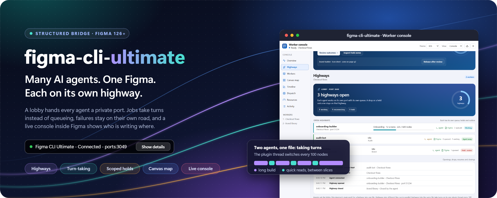

<h3>The multi-agent bridge for Figma Desktop</h3>

<p>Give every AI agent its own private road into Figma. Jobs take turns instead of queueing,<br>
failures stay where they happened, and a live console inside Figma shows who is writing where.</p>

<p>
  
  
  
  
  <a href="LICENSE"></a>
</p>

<p>
  <a href="#install"><b>Install</b></a> ·
  <a href="#highlights"><b>Highlights</b></a> ·
  <a href="#3-how-it-works"><b>How it works</b></a> ·
  <a href="#6-the-plugin-ui-banner-and-worker-console"><b>Worker console</b></a> ·
  <a href="#contents"><b>Documentation</b></a>
</p>

</div>

## Install

```bash
npm install -g github:camilogo1200/figma-cli-improvement
figma-ultimate setup
```

`setup` does everything in one go and tells you the one thing it can't do for you:

1. Builds the plugin and starts the bridge on `127.0.0.1:3049`.
2. Turns on **automatic start** at sign-in (Windows), so the bridge is always there.
3. Checks whether the plugin is registered in Figma. If not, it copies the manifest path to the
   clipboard: in Figma Desktop choose **Plugins → Development → Import plugin from manifest…** and
   paste. (Or quit Figma and run `figma-ultimate setup --register-figma` to skip even that.)
4. Waits for you to open a design file and run **Plugins → Development → figma-cli-ultimate**, then
   asks you to approve that connection **in the terminal**: compare the number and press <kbd>Y</kbd>.
   This computer is remembered for every file after that.

Something not working? `figma-ultimate doctor` checks every piece and prints the next step.

<sub>Needs Node.js 20+, Git and Figma Desktop. Tested on Windows 11 with Figma Desktop 126.x and Node 24.
Coming from an earlier version of this bridge? `setup` moves your pairings and reservations over by itself.
Prefer a clone? `git clone https://github.com/camilogo1200/figma-cli-improvement.git && cd figma-cli-improvement && npm ci && npm run setup`.</sub>

> [!NOTE]
> **figma-cli-ultimate** started as a fork of [silships/figma-cli](https://github.com/silships/figma-cli)
> v2.2.5 (upstream `630a0dd`). It keeps only the plugin bridge, rebuilt for many agents. The original
> CLI's design-system commands (`render`, tokens, blocks, extract, Yolo and Browser modes) are not
> included; use the original project for those.

## Highlights

<table>
<tr>
<td width="50%" valign="top">

**🛣️ A private highway per agent**<br>
The lobby on port 3049 opens a loopback port with its own ticket for each agent and file. Each
highway has its own queue, holds, outbox and timeline row. Up to 16 at once.

</td>
<td width="50%" valign="top">

**🔄 Turns, not traffic jams**<br>
Jobs from different highways share a file's plugin thread and switch every 100 nodes, so a
quick read no longer waits for someone else's whole build. Different files run fully in parallel.

</td>
</tr>
<tr>
<td valign="top">

**🧯 Failures stay local**<br>
An unknown outcome holds only the highway that produced it; every other agent keeps writing.
Held work is settled by the plugin's proof, or released after review in two clicks.

</td>
<td valign="top">

**🔌 Drops are not disasters**<br>
If an agent or a plugin socket drops, nothing is cancelled. Finished results wait in an outbox
and the connection resumes within 60 seconds, on the same port.

</td>
</tr>
<tr>
<td valign="top">

**📟 A control center inside Figma**<br>
The plugin starts as a one-line banner and opens into a resizable console: highways, workers,
timeline, dispatch, resources and every outcome, with where and how much.

</td>
<td valign="top">

**🗺️ A live canvas map**<br>
Every reserved zone, who is reading or writing where, measured progress, held areas and a
coarse sketch of each page, across all connected files.

</td>
</tr>
<tr>
<td valign="top">

**📐 Canvas-safe by construction**<br>
Atomic zone reservations with gutters, automatic free-space placement, collision checks at
every yield, and rollback that never deletes anyone else's nodes.

</td>
<td valign="top">

**🧩 One command to set up**<br>
`figma-ultimate setup` builds, starts, registers and pairs. Structured JSON commands replace the
`eval()` that Figma 126+ blocks, and pairing, build checks and session epochs keep stray clients out.

</td>
</tr>
</table>

## Before and after

| | Base plugin (figma-cli 2.2.5, Safe Mode) | figma-cli-ultimate |
|---|---|---|
| Runs on Figma Desktop 126+ | ✗ `eval()` is blocked | ✓ Structured JSON commands |
| Several agents at once | One socket; the last connection wins | ✓ One highway each (up to 16); up to 4 files in parallel |
| A quick job behind a long batch | No queue: requests race on one thread | ✓ Waits for at most one 100-node slice per other agent |
| A socket drops | Everything in flight is rejected | ✓ Nothing cancelled; results kept up to 60 s |
| An outcome is unknown | Not tracked | ✓ Only that highway is held; proof or release after review |
| Canvas collisions | Not checked | ✓ Atomic zones, automatic placement, own-node rollback |
| Getting started | `figma-cli connect --safe`, then pair by hand | ✓ `figma-ultimate setup`, approve once in the terminal |
| What you see in Figma | Connected / not connected | ✓ Banner and a resizable worker console |

**Why turns matter:** in a live run on 2026-10-20, before highways, a page switch queued behind layout
jobs took **28.7–31.0 s** end to end for **34–169 ms** of real work. With highways, that switch runs
between slices of the other jobs instead of after them.

> [!IMPORTANT]
> Highways are covered by the test suite (189 tests, over real loopback sockets and the real daemon
> process). They have **not yet run in live Figma**: the live results in
> [§13](#13-testing-and-measured-evidence) (25/25 acceptance checks, a 12,096-node stress run) predate them.

## See it

<table>
<tr>
<td width="50%">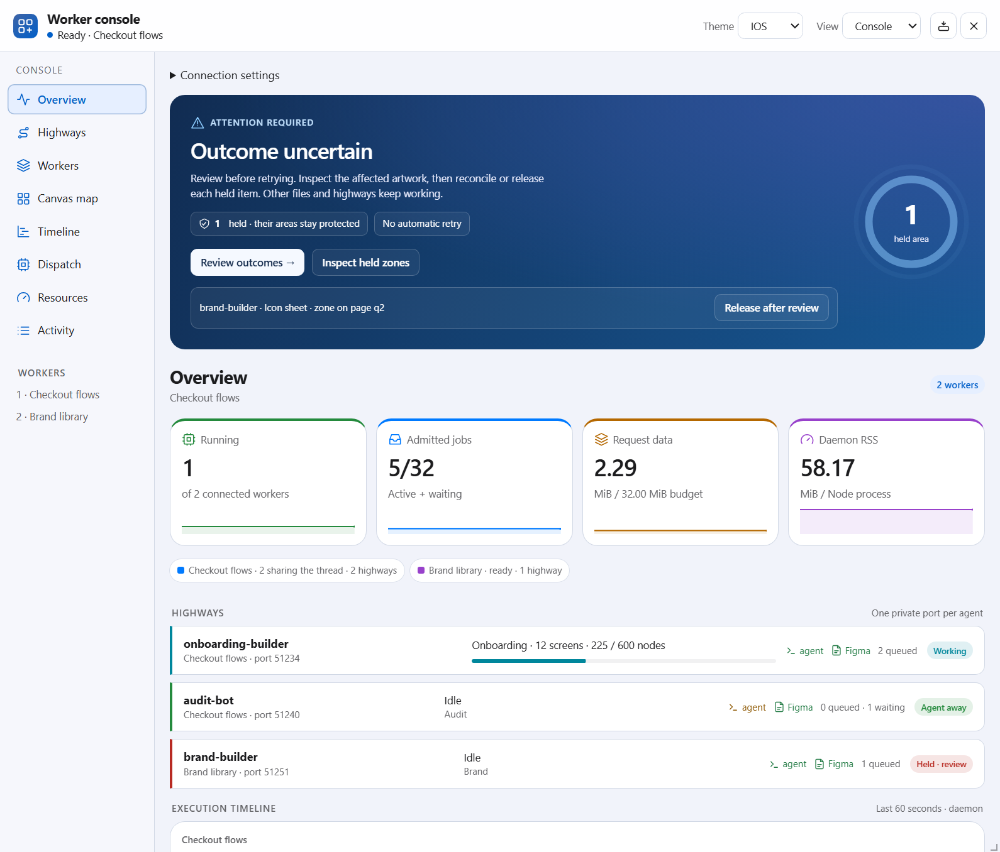<p align="center"><b>Overview</b> · metrics, highways, the attention panel</p></td>
<td width="50%">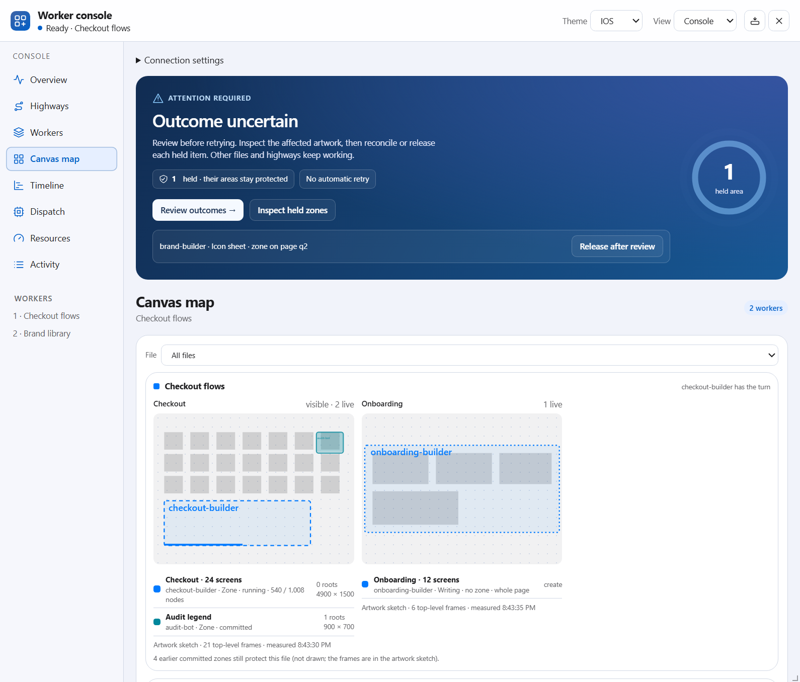<p align="center"><b>Canvas map</b> · zones, writes and reads per file</p></td>
</tr>
<tr>
<td>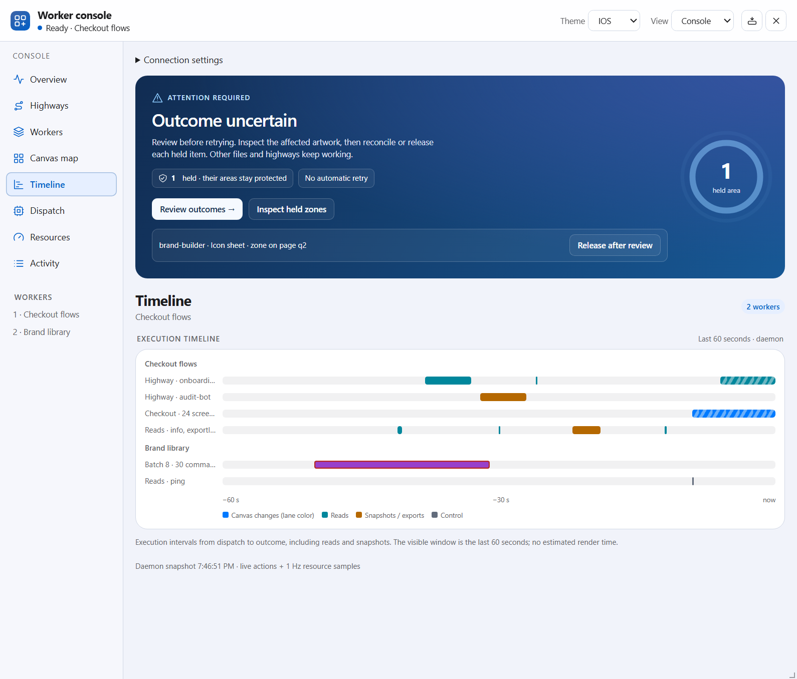<p align="center"><b>Timeline</b> · one row per highway</p></td>
<td>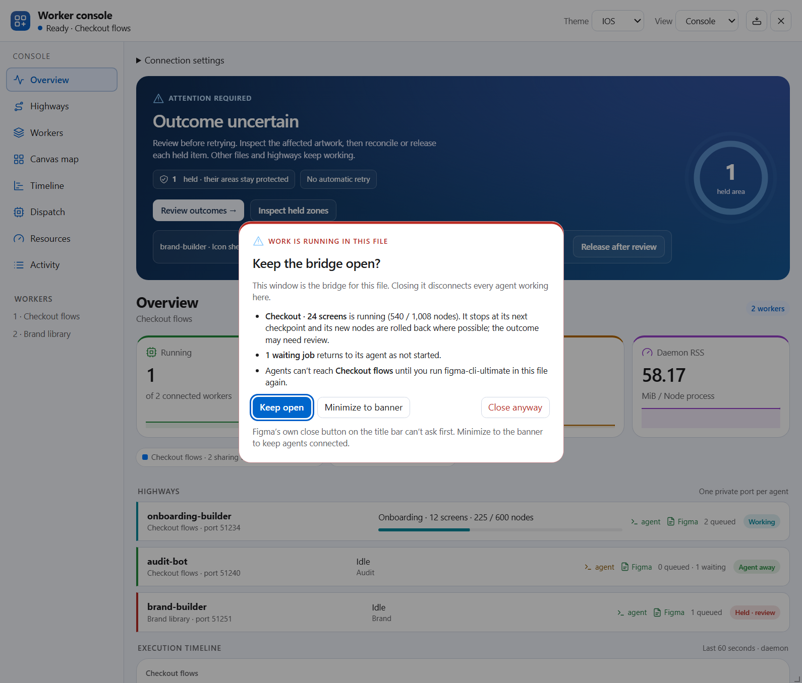<p align="center"><b>Close guard</b> · asks before ending live highways</p></td>
</tr>
</table>

<p align="center"><sub>The real <code>plugin/ui.html</code>, rendered with sample data by <code>npm run docs</code>.</sub></p>

## First commands

```bash
figma-ultimate files                       # connected files: name, key, page
figma-ultimate info --file "Checkout"      # pick a file by name or key when several are open
figma-ultimate find Button
figma-ultimate layout screens.json         # {"specs":[{"name":"Home","w":390,"h":844}]}: placed in free space
figma-ultimate export 12:34 home.png
```

### Two agents, one file

In your own project, add the client (`npm install github:camilogo1200/figma-cli-improvement`), then:

```js
import { forFile } from 'figma-cli-ultimate';

const FILE = 'YOUR_FIGMA_FILE_KEY';   // from: figma-ultimate files
const builder = forFile(FILE, undefined, { agentId: 'checkout-builder' });
const auditor = forFile(FILE, undefined, { agentId: 'audit-bot' });

// Each client opens its own highway on first use. The audit's search runs
// between slices of the build instead of waiting for all twelve screens.
const screens = Array.from({ length: 12 }, (_, i) => ({ name: `Checkout ${i + 1}`, w: 390, h: 844 }));
const [built, buttons] = await Promise.all([
  builder.createLayout(screens, { label: 'Checkout' }),   // reserved, auto-placed zone
  auditor.cmd({ op: 'find', name: 'Button' }),
]);

await Promise.all([builder.close(), auditor.close()]);
```

Open the console while it runs: both agents appear under **Highways**, the build's zone marches on the
**Canvas map**, and the **Timeline** shows the two rows taking turns.

---

## Contents

1. [Why this fork exists](#1-why-this-fork-exists)
2. [Improvements over the base plugin](#2-improvements-over-the-base-plugin)
3. [How it works](#3-how-it-works)
4. [Install and run](#4-install-and-run)
5. [Using the bridge](#5-using-the-bridge)
6. [The plugin UI: banner and worker console](#6-the-plugin-ui-banner-and-worker-console)
7. [Coordinator reference](#7-coordinator-reference)
8. [Concurrency and parallelism](#8-concurrency-and-parallelism)
9. [Reliability and the failure contract](#9-reliability-and-the-failure-contract)
10. [Memory management](#10-memory-management)
11. [Budgets and limits](#11-budgets-and-limits)
12. [Diagnostics](#12-diagnostics)
13. [Testing and measured evidence](#13-testing-and-measured-evidence)
14. [Protocol versions](#14-protocol-versions)
15. [Known limits](#15-known-limits)
16. [Relationship to figma-cli](#16-relationship-to-figma-cli)
17. [Documentation images](#17-documentation-images)
18. [Contributing](#18-contributing)
19. [License and credits](#19-license-and-credits)

---

## 1. Why this fork exists

**Figma 126+ rejects `eval()` inside the plugin sandbox.** Stock Safe Mode sends JavaScript strings for
the plugin to evaluate, so on current Figma Desktop it cannot run anything. This fork replaces evaluated
code with **structured JSON commands** (`{ op: 'create', spec: … }`) that the plugin interprets itself.

A review of the stock bridge under real load (≈2,200 generated frames, 160k–200k nodes per 676 frames)
found a chain of problems behind the freezes and disconnects on long runs:

1. **False disconnects.** The UI keepalive closed the socket after 8 s without a pong. A busy Figma main
   thread looked like a dead connection.
2. **Everything in flight was rejected.** The daemon held exactly one plugin socket (`pluginWs`), and any
   close rejected every pending request, even ones belonging to another socket.
3. **Retries ran beside the original.** There was no queue and no cancellation, so a timed-out batch kept
   running while the client's retry started a second copy.
4. **The main thread starved.** There were no yields inside batches. `find` walked every node on the page,
   and every export copied the PNG several times.
5. **One connection only.** The single `pluginWs` was the hard blocker for any parallel work.

Protocols 2 to 4 fixed that chain and added paired multi-file workers, page lanes, durable canvas
reservations and a console. Running **several agents at once** then exposed a second chain:

6. **Head-of-line blocking.** Each file ran one job at a time, start to finish. A page switch queued
   behind layout jobs took **28.7–31.0 s** end to end, but only **34–169 ms** of real work (measured
   2026-10-20). The plugin "stopped, worked, stopped".
7. **A dropped socket cancelled everything and lost the result**, which then counted as uncertain.
8. **A slow native call became a disconnect.** After a timeout the plugin had 5 s to acknowledge the
   cancel; a 10 s page switch could not, so the daemon dropped it (see 7).
9. **One uncertain job held the whole file**, and some of those holds could only be cleared by editing
   the journal by hand and restarting the daemon.
10. **Finished zones blocked forever.** Any committed reservation refused every write without a zone in
    that file, so old test runs kept files locked.

Highways, scoped holds, turn-taking inside the plugin and the new console are the answer to that second
chain.

## 2. Improvements over the base plugin

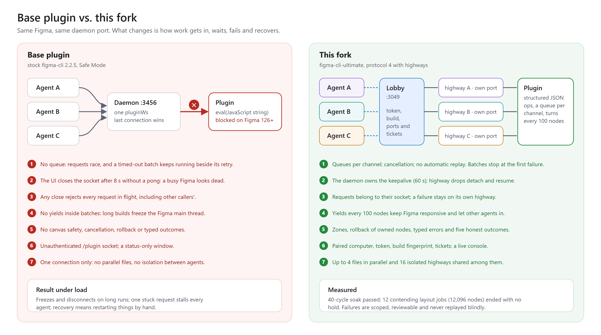

| Area | Base plugin (stock figma-cli 2.2.5, Safe Mode) | This fork |
|---|---|---|
| Plugin execution | `eval()` of JS strings (blocked on Figma 126+) | Structured JSON ops interpreted in the plugin |
| Connections | One plugin socket; last connection wins | Paired file workers (up to 4 files), each with a control socket plus one socket per highway |
| Several agents | Share one socket and race | Each agent gets a **highway**: its own port, queue, holds, outbox and timeline row |
| Scheduling | None; requests race | FIFO per channel; inside a file, channels **take turns every 100 nodes**; files run in parallel |
| Cancellation | None | Queued jobs dropped instantly; running jobs stop at node boundaries and roll back owned nodes |
| Failure reporting | "Daemon unreachable" for everything | Typed errors (`kind`) and outcomes: `not-started`, `rolled-back`, `partial`, `failed`, `uncertain` |
| Failure isolation | One failure rejects everything in flight | Holds are **scoped to their channel**; other highways and the file keep working |
| Socket drops | Everything cancelled | Highway ends **detach and resume** within 60 s; results are kept, nothing is cancelled |
| Keepalive | UI ping every 3 s, close after 8 s | The daemon owns the keepalive (15 s ping, 60 s silence); the UI never kills a busy worker |
| Canvas safety | None; frames could overlap existing art | Atomic zone reservations with gutters, collision/overflow checks at every yield, automatic placement |
| Recovery | None | Durable journal; interrupted work is held, never replayed; reconcile by proof or **release after review** |
| Security | Unauthenticated `/plugin` WebSocket | Token + exact build for the lobby, explicit computer pairing, session epochs, per-highway tickets |
| Plugin UI | Small connection status window | **Banner** that opens into a resizable **worker console**: highways, canvas map, timeline, activity |
| Observability | None | Every read, write, export, scan and release leaves a receipt: where, how much, how long, never contents |
| State | Shared `~/.figma-ds-cli` | Dedicated `~/.figma-cli-ultimate` (no collisions with other figma-cli copies) |
| Setup | `figma-cli connect --safe` by hand, shared port 3456 | `figma-ultimate setup`: build, start, automatic start, plugin registration and pairing in one command, on its own port 3049 |
| Memory | Hot-reloaded temp ES modules, all pages preloaded | Bounded queues and caches, operation-scoped fonts, no page preload, measured |

**Not included:** the original CLI’s commands (`render`, `render-batch`, `eval`, `blocks`, `shadcn`,
`tokens`, …) rely on evaluated code or on patching Figma, so 3.0.0 removed them. The daemon answers
`eval` and `render` requests with an explanation. Everything goes through structured commands.

---

## 3. How it works

### 3.1 The big picture

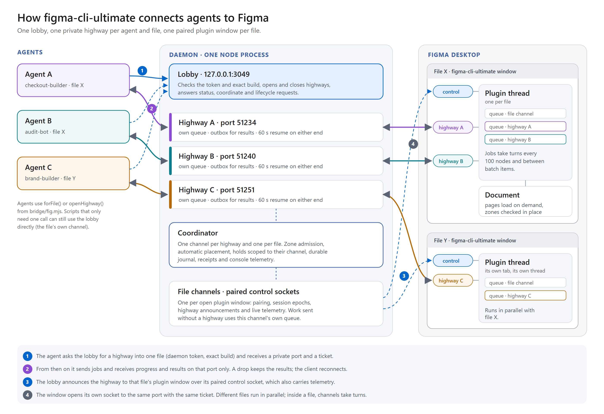

There are four moving parts:

- **Agents** are scripts or AI agents that use [`bridge/fig.mjs`](bridge/fig.mjs) or
  [`file-client.mjs`](file-client.mjs).
- **The daemon** is one Node process. Its main port (3049) is the **lobby**: it checks the daemon token
  and the exact build, opens and closes highways, and answers status, coordination and lifecycle
  requests. Behind it, the **coordinator** owns one *channel* per highway and one per file, the zone
  reservations, the holds, the journal and the console telemetry.
- **The plugin window** (`plugin/ui.html`) runs inside Figma, one per file. It holds a **paired control
  socket** to the daemon plus one socket per highway into that file. It also renders the console.
- **The plugin thread** (`plugin/code.js`) is the only code that can touch the Figma document. Figma
  runs one plugin instance per file, on that tab's main thread.

How an agent gets its own road:

1. The agent asks the lobby for a highway into one file and receives a private port and a ticket.
2. From then on it sends jobs and receives progress and results on that port only.
3. The lobby announces the highway to that file's plugin window over the paired control socket.
4. The window opens its own socket to the same port with the same ticket.

Different files run truly in parallel, because each Figma tab has its own thread. Inside one file,
every channel has its own queue and the channels take turns on the one plugin thread.

### 3.2 One request, end to end

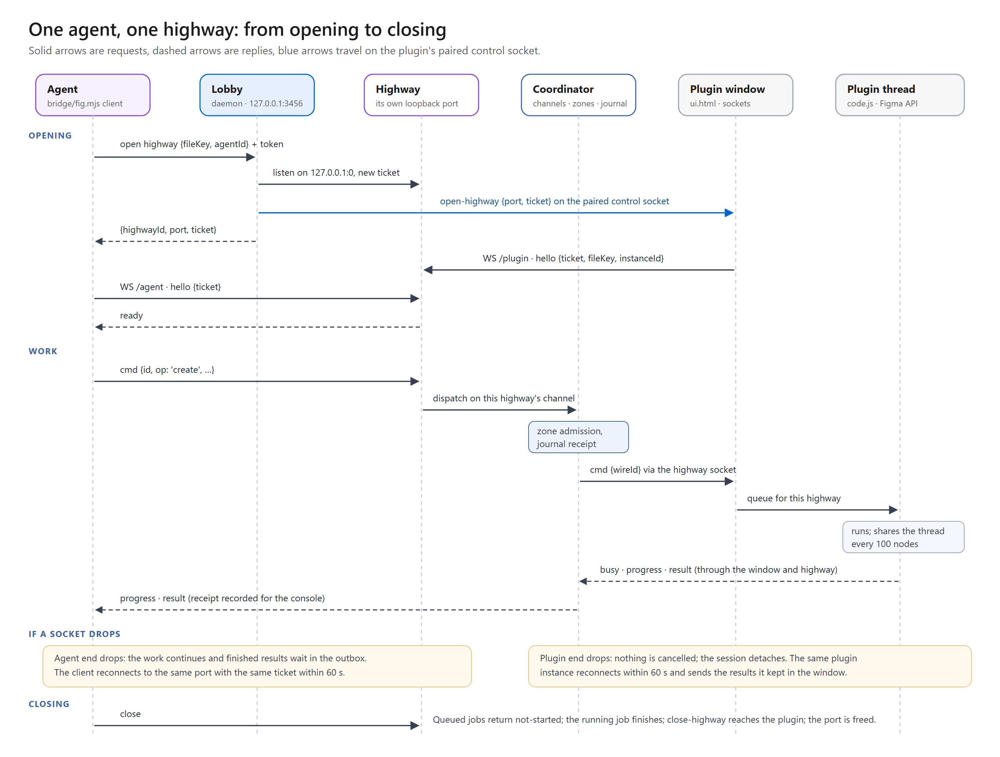

A request travels agent → highway → coordinator (zone admission, journal receipt) → the highway's plugin
socket → the plugin thread, and the replies come back the same way: `busy`, `progress`, then the result.
The coordinator records a receipt for the console, with the target page and node, the number of results
and the bytes returned, but never the contents.

If either end of a highway drops, nothing is cancelled. A dropped agent finds its results in the
highway's outbox when its client reconnects. The highway's plugin session detaches and is resumed by
the same plugin instance within 60 seconds, and the window then sends the results it kept. Closing a
highway returns queued jobs as `not-started` at once and lets the running job finish first.

### 3.3 Sharing one file: turns, not waiting

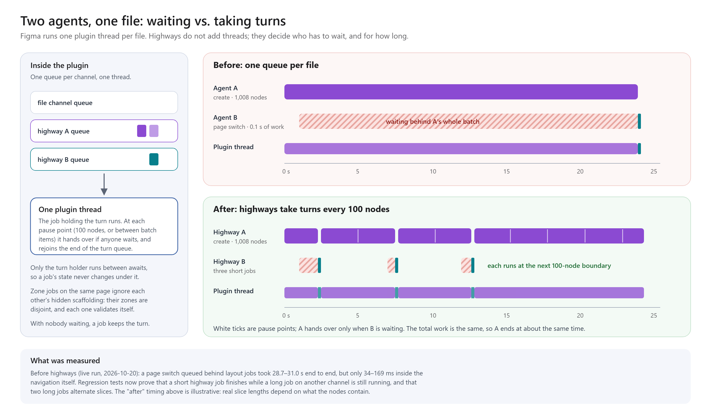

Highways do not add threads: there is still exactly one plugin thread per file. What changes is who
waits. Each job pauses every 100 nodes and between batch items, already to keep Figma responsive. At
each pause point, if a job from another channel is waiting, the running job hands over the thread and
rejoins the end of the turn queue (round robin). A short job therefore waits for at most one slice of
someone else's batch, not the whole batch.

Only the job holding the turn runs between awaits, so no job's state changes under it. When two zone
jobs share a page, each one ignores the other's hidden scaffolding while validating. Their zones are
disjoint (the coordinator guarantees it at admission), and each validates itself before committing.

### 3.4 Canvas safety: zones

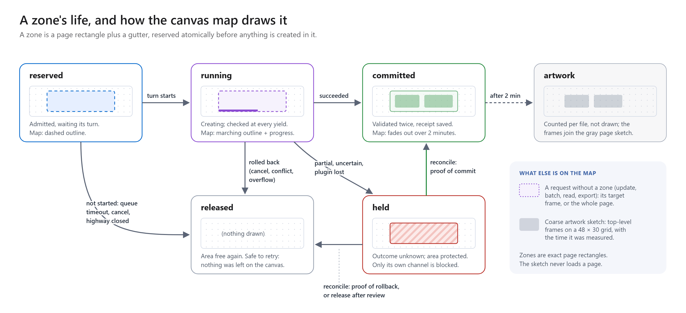

A **zone** is a page rectangle plus a gutter, reserved atomically before anything is created in it.
Zone-against-zone overlap is refused at admission. In the plugin, existing artwork, effects and
descendant bounds are checked again: initially, after font loading, at every yield and twice before
commit. Overflow or collision rolls back the job's own nodes, never anyone else's. **Automatic
placement** scans the page, picks free space with a 48 px gap and reserves it durably before creating.

Writes without a zone (updates, removals, batches) are not refused because other zones exist. They
cannot know an in-flight job's node IDs, and every zone job validates its own area and rolls back if
something intrudes.

### 3.5 When something goes wrong

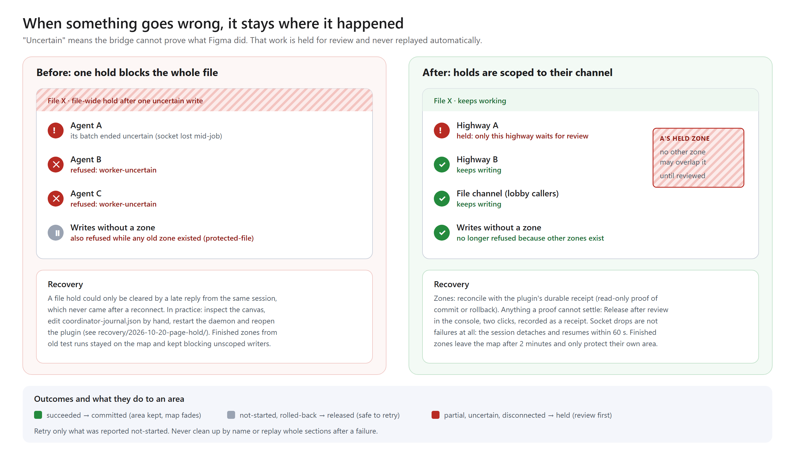

*Uncertain* means the bridge cannot prove what Figma did. That work is **held** for review and never
replayed automatically. A hold is scoped to the channel that produced it: an uncertain job on a highway
holds that highway only, and the held zone's area stays protected against overlapping zones. Zone holds
can be **reconciled** with the plugin's durable receipt (a read-only proof of commit or rollback).
Anything a proof cannot settle can be **released after review** from the console, with two clicks,
recorded as a receipt. Retry only what was reported `not-started`.

### 3.6 Seeing it

The plugin window starts as a one-line **banner** and opens into the **worker console**: open
highways, a canvas map of who is reading or writing where, a timeline with one row per highway, and
every outcome with its target and size. See [§6](#6-the-plugin-ui-banner-and-worker-console).

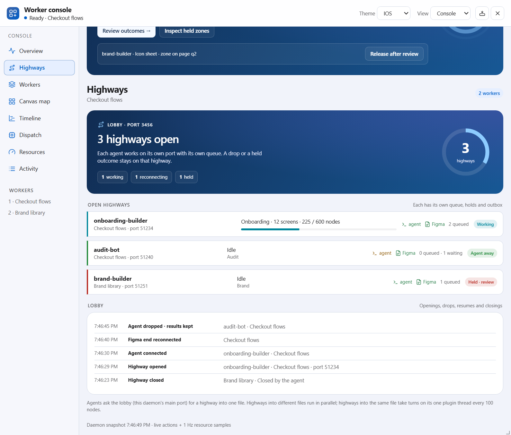

### 3.7 Source map

| Module | Role |
|---|---|
| `src/daemon.js` | HTTP + WebSocket server (the lobby), plugin mode only, no hot-reloaded temp modules |
| `src/lib/bridge-highways.js` | Highways: per-agent loopback ports, tickets, agent and plugin sockets, outbox, resume windows, closing |
| `src/lib/bridge-coordinator.js` | Workers and highway channels, lanes, fair scheduling, dependencies, zone admission, scoped holds, release, receipts, telemetry |
| `src/lib/structured-bridge.js` | Per-socket request ownership, queue, cancel, keepalive; detach and resume for highway sockets; page sketches and targets |
| `src/lib/bridge-http.js` | Bounded body parsing, upload/response deadlines |
| `src/lib/bridge-protocol.js` | Protocol number, wire limits (mirrored in `plugin/code.js`), typed errors |
| `src/lib/bridge-layout.js` | Automatic free-space placement |
| `src/lib/bridge-lifecycle.js` | Guarded document lifecycle (inspect/reload through local CDP) |
| `src/lib/bridge-pairing.js` | Pairing codes, persistent credential hashes, approvals from a terminal or the Windows dialog |
| `src/lib/bridge-state.js` | `~/.figma-cli-ultimate` paths, token, PID |
| `src/lib/bridge-build.js` | Source fingerprints for plugin/daemon build identity |
| `plugin/code.js` | Structured-op interpreter, one queue per channel with turn-taking, yields, rollback, spatial checks, page sketches, window sizing |
| `plugin/ui.html` | Control and highway sockets, pairing, the banner, the worker console and the close confirmation |
| `bridge/fig.mjs` | Client library, including `openHighway()` and `HighwayClient` (`figma-cli-ultimate/client`) |
| `file-client.mjs` | File-bound client, the package’s main export; uses a highway by default |
| `bin/figma-ultimate.mjs`, `cli/index.mjs` | The `figma-ultimate` command: setup, doctor, lifecycle, file commands |
| `cli/figma-plugins.mjs` | Plugin registration in Figma Desktop’s settings (guided or automatic) |
| `cli/previous-version.mjs` | One-time upgrade from an earlier installation of this bridge |
| `bridge/launcher.mjs` | Build stamping and the guarded daemon lifecycle (used by the CLI and the companion) |
| `bridge/companion.mjs`, `*.ps1` | Windows sign-in companion and pairing approval dialog |

---

## 4. Install and run

| | |
|---|---|
| Command | `figma-ultimate` (also `figma-cli-ultimate`) |
| Plugin name in Figma | **figma-cli-ultimate** (manifest id `figma-cli-ultimate`) |
| Bridge protocol | **4** (with highways) |
| Daemon | `127.0.0.1:3049`. That port is the **lobby** |
| Highways | One private loopback port per agent and file, opened by the lobby ([§5.4](#54-highways-one-private-port-per-agent)) |
| Settings folder | `~/.figma-cli-ultimate` (token, PID, pairings, coordinator journal) |
| Platform tested | Windows 11, Figma Desktop 126.x, Node 24 |

### 4.1 Requirements

- Figma Desktop (tested on 126.x). The browser version of Figma cannot reach a local bridge.
- Node.js 20 or newer, with `npm`.
- Git (npm uses it to install from GitHub).
- Windows for automatic start at sign-in. Everything else is plain Node; on macOS, run
  `figma-ultimate start` after signing in (untested so far).

### 4.2 Install

| Way | Commands | Best for |
|---|---|---|
| **From GitHub** (recommended) | `npm install -g github:camilogo1200/figma-cli-improvement`<br>`figma-ultimate setup` | Using it. One command, no clone to keep around |
| A tag or branch | `npm install -g github:camilogo1200/figma-cli-improvement#<tag>` | Pinning a release |
| **Clone** | `git clone https://github.com/camilogo1200/figma-cli-improvement.git`<br>`cd figma-cli-improvement && npm ci && npm run setup` | Changing the code. The clone folder is the installation |

The package ships only what runs: 30 files, about 145 kB, one dependency (`ws`).

### 4.3 What `figma-ultimate setup` does

Run it once per computer, and again whenever something seems off. Every step is safe to repeat.

1. Checks Node.js and stamps the plugin build. The daemon and the plugin refuse to work with a
   mismatched build, so a stale plugin can never write.
2. **Upgrades an earlier installation of this bridge** (it used port 3456 and another settings folder):
   turns off its automatic start, stops its daemon if it is idle, and copies the pairings and the
   reservation journal over. If that daemon is still working, setup stops and asks you to wait. An
   installation from another folder, or any other program, is left alone.
3. Starts the bridge on `127.0.0.1:3049`, or restarts it if it runs an older build.
4. Turns on **automatic start** (Windows): a sign-in companion checks every 5 s and starts the bridge
   when it is missing. It never kills Figma, replaces another installation's daemon or replays work.
   Skip it with `--no-autostart`; change it later with `figma-ultimate autostart on|off`.
5. Registers the plugin in Figma, or tells you exactly how ([§4.4](#44-register-the-plugin-in-figma)).
6. Waits for the plugin to connect and lets you approve it in the terminal ([§4.5](#45-pair-once)).
   <kbd>Ctrl</kbd>+<kbd>C</kbd> stops waiting; the bridge keeps running. `--no-wait` skips this step.

### 4.4 Register the plugin in Figma

Figma Desktop only runs development plugins it has been told about, and it has no supported way for
another program to add one. You have two options:

- **Guided (default).** Setup copies `plugin/manifest.json`'s full path to the clipboard. In Figma
  Desktop choose **Plugins → Development → Import plugin from manifest…** and paste. Once per computer.
- **Automatic.** Quit Figma, then run `figma-ultimate setup --register-figma` (or
  `figma-ultimate register --figma-settings`). It writes the entry into Figma's own `settings.json`
  (`localFileExtensions`) and removes other registrations of this plugin and entries no plugin uses.
  Other plugins are not touched. Figma must be closed because it rewrites that file when it quits,
  and setup keeps a timestamped backup next to it. Figma does not document this file, so a future
  Figma update could change its format; the guided import always works.

The plugin uses Figma's private plugin API to attest the file key it is running in. Figma does not
allow that in Community plugins, so this plugin is installed from its manifest rather than published.
Teams can publish it privately inside a Figma organization instead.

### 4.5 Pair once

Open a design file and run **Plugins → Development → figma-cli-ultimate**. It opens as a small banner
in the canvas's bottom-left corner. Keep it open: the window *is* the bridge for that file.

The first time, the plugin asks to connect and shows a six-digit number. Approve it where you see the
same number:

- **In the terminal** running `figma-ultimate setup` (or `figma-ultimate approve`). Press <kbd>Y</kbd>.
  While a terminal is waiting, no dialog opens.
- **In a Windows dialog**, when no terminal is waiting.
- **Manually**: `figma-ultimate pair` prints a two-minute code; paste it under
  **Show details → Advanced pairing & setup**.

The computer is then remembered in every file. **Connection settings → Forget this computer** revokes it.

### 4.6 Check

```bash
figma-ultimate doctor
```

`doctor` checks Node.js, the plugin build, an earlier installation, the bridge, automatic start, the
plugin's registration in Figma and the connected files, and prints the command or click that fixes
each problem. It exits non-zero when something blocks work. `figma-ultimate status` is the one-line
version (`--json` for scripts).

### 4.7 Update, restart, uninstall

- **Update:** run the install command again, then `figma-ultimate setup`. A new build restarts the
  bridge; close and reopen the plugin in each open file (it shows a build mismatch until you do).
- **Restart:** `figma-ultimate restart`. Guarded: it refuses while work is active or uncertain and never
  kills a process by a PID it read from a file.
- **Uninstall:** `figma-ultimate uninstall` turns off automatic start and stops the bridge. Then remove
  the plugin in Figma (**Plugins → Development → Manage plugins in development**) and run
  `npm uninstall -g figma-cli-ultimate`. Pairings stay in `~/.figma-cli-ultimate` until you delete it.

### 4.8 After editing the source

1. Turn off **Plugins → Development → Hot reload plugin**. A save with hot reload on can interrupt an
   active job.
2. Wait until all workers are idle.
3. Run `figma-ultimate build`, then `figma-ultimate restart`.
4. Close the plugin window in each file and run it again.

Until step 3, **new client processes from this folder are refused** by the running daemon
(`build-mismatch`): their build fingerprint already describes the edited sources. Long-running
processes that started earlier keep working against the old daemon. The fingerprint covers the code,
not the folder, so a global install and a local install of the same release share one daemon.

### Command reference

| Command | Purpose |
|---|---|
| `setup [--register-figma] [--no-autostart] [--no-wait]` | Everything above, once |
| `doctor [--json]` | Check every piece and print the next step |
| `status [--json]` | One-line summary: port, files, highways, held work |
| `start` / `stop` / `restart` | Guarded daemon lifecycle |
| `build` | Stamp the plugin build after editing the source |
| `autostart on` / `autostart off` | Windows sign-in companion |
| `register [--figma-settings]` | Guided or automatic plugin registration |
| `approve` | Approve a waiting plugin connection in this terminal |
| `pair` | Two-minute manual pairing code |
| `uninstall` | Turn off automatic start and stop the bridge |
| `files`, `info`, `pages`, `find`, `children`, `tree`, `export`, `send`, `layout`, `cancel` | Work with a file ([§5.1](#51-from-the-terminal)) |
| `highways`, `lanes`, `workers`, `diagnostics` | Inspect the coordinator (JSON) |

Environment: `FIGMA_ULTIMATE_FILE` picks the default file for file commands, `FIGMA_ULTIMATE_STATE_DIR`
moves the settings folder, and `FIGMA_ULTIMATE_PORT` moves the daemon for tests only (the plugin always
dials 3049).

---

## 5. Using the bridge

### 5.1 From the terminal

```bash
figma-ultimate files                        # connected files: name, key, page, busy, needs review
figma-ultimate info                         # file, page, worker identity
figma-ultimate pages
figma-ultimate children "UI / "             # direct page children (optional name prefix), with duplicate report
figma-ultimate find "Button"
figma-ultimate tree <nodeId>
figma-ultimate export <nodeId> out.png
figma-ultimate send commands.json           # one command object or an array (= batch)
figma-ultimate layout layout.json           # {"specs":[…], "pageId":"…", "label":"…"}: placed in free space
figma-ultimate cancel [requestId]
figma-ultimate highways                     # open highways: agent, file, port, both ends, queue
figma-ultimate workers                      # full coordinator status
```

With one file connected, commands go to it. With several, add `--file NAME` (a unique part of the
file name) or `--file KEY`, or set `FIGMA_ULTIMATE_FILE`. Output is JSON. `send` and `layout` take a
**file path**, not inline JSON. These one-shot commands use the lobby (the file's own channel);
long-running agents should use a highway ([§5.4](#54-highways-one-private-port-per-agent)).

### 5.2 Operations

`ping`, `info`, `cancel`, `create`, `update`, `find`, `children`, `tree`, `remove`, `select`, `page`,
`audit`, `fonts`, `reactions`, `flowStart`, `image`, `exportImage`.

- **`create`** accepts `spec` or `specs`. Common fields: `type`, `name`, `children`, `layout: ROW|COL`,
  `w/h`, `wSize/hSize: FILL|HUG`, `gap`, `p/px/py/pt/pr/pb/pl`, `justify/items`, `fill/stroke`, `radius`,
  `text/font/weight/style/size/color`, `lineHeight`, `x/y`, `effects` (DROP_SHADOW, BACKGROUND_BLUR,
  LAYER_BLUR), `opacity`, `clip`. SVG: `{type:'SVG', svg, w}`. It also supports native `SECTION` nodes,
  component instances (`{type:'INSTANCE', of: componentId}`), dashed borders and arrowheads.
- **`image`** `{op:'image', base64}` returns a reusable image hash. Identical bytes reuse the same hash.
- **`page`** `{op:'page', action:'list'|'create'|'select'|'rename'|'update'}`. Use explicit page IDs as
  parents for page-specific builds; creation never needs the page to be visible.
- **`fonts`** `{op:'fonts', query}` lists families and styles. Weight keywords map to style names,
  including the `Semi Bold` / `SemiBold` / `Semibold` spellings.

Every operation reports what it reads or writes (page, node, page-space box) to the console map while it
runs.

### 5.3 Node scripts

Add the package to your project (`npm install github:camilogo1200/figma-cli-improvement`). It exports
the file-bound client as `figma-cli-ultimate` and the low-level client as `figma-cli-ultimate/client`:

```js
import { cmd, cmdBatch, coordinate, createLayout, health } from 'figma-cli-ultimate/client';

await cmd({ op: 'create', parent: pageId, spec, select: false }, 120000);
await cmdBatch(commands, 120000, { queueTimeoutMs: 30000, signal });
```

Without installing, import the file from a clone instead. On Windows use a `file:///` URL
(`file:///C:/path/to/figma-cli-improvement/bridge/fig.mjs`); a bare `C:/…` specifier fails with
`ERR_UNSUPPORTED_ESM_URL_SCHEME`.

With **more than one file connected, every caller must target a file**. An unscoped command is rejected
instead of guessed. Route by worker:

```js
const { workers } = await coordinate({ op: 'status' });
const w = workers.find(w => w.fileKey === FILE_KEY);
const route = { workerId: w.workerId, sessionEpoch: w.sessionEpoch, fileKey: w.fileKey };
await cmd(createCommand, 120000, {
  queueTimeoutMs: 60000,
  coordination: { ...route, requestId, laneId, agentId, pageId, rect: { x, y, w, h }, gutter: 24 },
});
```

Or let the coordinator find free space:

```js
await createLayout([{ name: 'Checkout screen', w: 390, h: 844 }], { fileKey: FILE_KEY, label: 'Checkout' });
```

### 5.4 Highways: one private port per agent

```js
import { openHighway } from 'figma-cli-ultimate/client';

const road = await openHighway(FILE_KEY, { agentId: 'checkout-builder', label: 'Checkout' });
await road.cmd({ op: 'create', parent: pageId, specs, placement: 'auto', select: false, zoom: false }, 120000,
  { coordination: { pageId, placement: 'auto', label: 'Checkout' }, onProgress: p => console.log(p.done, p.total) });
await road.cmdBatch(commands);
await road.close();   // waits for this client's own requests, then frees the port
```

`forFile(fileKey)` from [file-client.mjs](file-client.mjs) uses a highway **by default**. Set
`FIGMA_ULTIMATE_TRANSPORT=shared` (or pass `{ mode: 'shared' }` as the third argument) for the shared
lobby path. The highway decides the file and session; an agent can only describe its zone
(`coordination` without `workerId`, `sessionEpoch` or `fileKey`).

What a highway guarantees:

| Event | What happens |
|---|---|
| Another agent runs a long batch in the same file | Nothing waits at the daemon. In the plugin, jobs from different highways **take turns** every 100 nodes and between batch items |
| The agent's socket drops | The work continues. Finished results wait in the highway's outbox. The client reconnects to the same port by itself and receives them. After 60 s without the agent, the highway closes |
| The plugin's highway socket drops | Nothing is cancelled and nothing becomes uncertain. The same plugin instance reconnects within 60 s and delivers the results. A reopened plugin is a new instance and cannot inherit unfinished work |
| A job ends uncertain | Only **that highway** is held. The file's own channel and every other highway keep writing |
| The agent closes it, or the lobby does | Queued jobs return `not-started` at once. The running job finishes first, then the port closes |
| The agent never connects | The highway closes by itself after 30 s |
| A script never calls `close()` | It still exits: an idle highway does not keep the Node process alive |

Highways are authenticated twice: the lobby call needs the daemon token and the exact build, and
the highway port accepts only its ticket. The plugin learns about a highway only over its paired
control socket. Ports are OS-assigned and bound to 127.0.0.1. Tickets never appear in telemetry.

### 5.5 Batches

A batch (`cmdBatch`, up to 128 commands) is **one job**. It keeps its order and stops at the first
failure. Later items are marked `skipped` and earlier successes remain. `cmdBatch` throws a
`BridgeError` with `kind: 'batch-failed'`, `outcome: 'partial'` and the per-item `results`. Dependent
steps are never split between workers. On a highway, other channels may take turns between its items.

### 5.6 Heavy-page navigation and recovery

`{ op: 'page', action: 'select', id }` is navigation, not an artwork edit. It resolves
the page from the document's page list, loads it with `PageNode.loadAsync()`, then
awaits `figma.setCurrentPageAsync()`. Selecting the current page is a no-op. Navigation
has a **120-second default execution budget**, consistently in the client, coordinator,
and transport; explicit shorter deadlines still apply. Queue waiting remains a
separate deadline (30 seconds by default). Builders rarely need it: creation targets a page by ID
without changing the visible page.

The two recorded failures on 2026-10-20 lasted 10.609 and 10.451 seconds and had
`kind: plugin`. Their native exception text was lost when the caller's `finally`
block tried to restore the previous page. A standalone select does not enter the
UI yield loop: that watchdog reports `yield-timeout`, while the daemon execution
timer reports `daemon-timeout`. This identifies the Figma API path as the likely
source, but does **not** prove an undocumented ten-second `setCurrentPageAsync`
limit.

Navigation failures retain `details.navigation` with the phase (`lookup`,
`load`, or `switch`), requested/previous/current page IDs, duration, and the native
error (bounded to 512 characters). The coordinator keeps this metadata in its
receipts, even if caller cleanup masks the error. Loading failures are `not-started`;
failures after invoking the switch are `failed`, with the actual page recorded. If the
native promise rejects after the target is already current, the plugin can reconcile
that selection as success. No native switch is automatically retried.

A standalone select or an all-select batch never creates a hold. A failed
select preceding only skipped writers also releases that batch's hold once every
writer's terminal result proves `not-started`/`rolled-back`. Page creation, rename,
update, and batches with successful or uncertain artwork writes keep their
protections. Navigation does not commit an undo boundary. Cancellation still waits for
the native call to settle; an expired select is `uncertain` while running, never falsely
`not-started`.

### 5.7 Live navigation and layout stress test

`tests/live/navigation-stress.mjs` recreates the coordinator acceptance fixture:
24 independent 180 × 240 cards per job, each with a colored header and 40 filled or
outlined geometric cells (1,008 nodes per job). Three callers first contend on one
new test page, then lay out on different pages. All creation uses explicit parents,
automatic placement, and `select: false`, `zoom: false`. Existing heavy pages are
navigation targets only. No artwork/pages are deleted, no mutations are replayed,
and the runner never restarts the daemon, reloads the plugin, or edits its journal.

The runner provides three distinct measurements:

- `baseline`: native page navigation without layout work.
- `queued`: page selections submitted during layouts. Wall latency includes queue
  waiting; `navigation.elapsedMs` measures plugin navigation after dispatch.
- `ui`: actual Figma UI page changes while a different page is being populated.
  The runner emits `switch-in-figma-ui` events and records `nextSwitch` in its report.
  Click the named page through Figma's UI (manually or using Computer Use). An
  automation driver may instead supply `onUiSwitch` to the exported `runStress`.
  Never implement that hook with `page.select`, which would serialize behind layout.

Preview the plan without contacting Figma:

```powershell
node tests/live/navigation-stress.mjs --plan --mode all
```

After rollout approval, run it against an idle file (it creates three labeled test pages and respects
existing reservation guards):

```powershell
node tests/live/navigation-stress.mjs --run --mode all --file-key <FILE_KEY> --switch-pages "<pageId>,<pageId>"
```

The approved 2026-10-20 live run completed all 12 jobs (288 roots / 12,096 nodes),
verified page ownership and dimensions, and ended without a hold or quarantine.
Baseline native navigation took 120–254 ms; queued navigation took 28.7–31.0 s
overall but only 34–169 ms inside the navigation operation. Three recorded UI
clicks were observed within the same executing layout, with 629–1,782 ms from
input to the bridge sample. The evidence is kept locally, outside the repository.
The three test pages were subsequently removed at the user's request and the 12 test
reservations released, with all original pages and unrelated journal records preserved
(`cleanup-verification.json`). That run predates highways; its queued numbers are the
"before" in [§3.3](#33-sharing-one-file-turns-not-waiting).

---

## 6. The plugin UI: banner and worker console

**Stock:** a small status window that scanned ports 3456–3460, kept the first socket that opened, pinged
every 3 s and closed the socket after 8 s without a pong. It showed "connected / not connected" and
nothing about the work.

**This fork:** the plugin window is both the bridge for its file and a **control center** for every
connected file. It starts as a one-line banner and opens into a console that shows who holds the
thread, what is queued, every highway, which canvas areas are reserved and who is writing where, how
far each job has progressed (measured, never estimated) and every outcome.

*The screenshots in this section are the real `plugin/ui.html` with sample data (see
[§17](#17-documentation-images)).*

### 6.1 Views and window

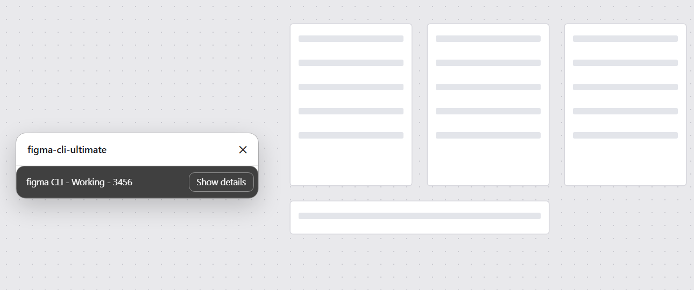

Every session **starts as the banner** in the canvas's bottom-left corner: one line,
`figma CLI - <status> - <port>`, and **Show details**. Black at 75 % opacity, white text, rounded
border. The status is Connected, Working, Needs review, Connecting, Connect this computer or
Disconnected.

**Show details** opens Compact. Drag any edge or corner to resize: the layout follows the size
(Compact below 480 px tall, Standard up to 720 px wide, Console beyond). Left and top edges move the
window as they resize it. **View** in the header jumps to a preset, and the minimize button returns to
the banner.

| View | Size | Shows |
|---|---|---|
| **Banner** | 300 × 40 | Product, status and port, and **Show details** |
| **Compact** | 360 × 300 | Local job, resolved target page, node progress, elapsed time, running files, waiting jobs, held areas, connected files, admitted bytes. It subscribes only to a small summary |
| **Standard** | 360 × 600 | The full sections in a narrow column |
| **Console** | 1060 × 904 | The full dashboard with side navigation, charts and maps |

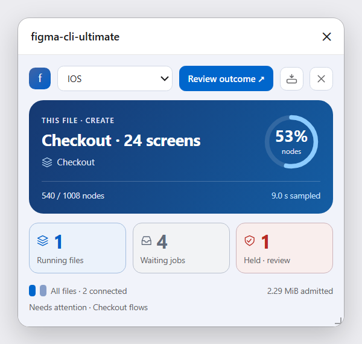

Figma always draws its own title bar above the plugin window, and the area behind the window is the
window's own background, not the canvas. The banner is therefore a dark translucent strip inside the
smallest window, not a borderless overlay.

### 6.2 Closing asks first


Closing the plugin window disconnects every agent and highway working in that file. The close button
in the plugin's header and compact view asks first. It lists the running job (with progress) and the
waiting jobs, and offers **Keep open**, **Minimize to banner** or **Close anyway**. Figma's own close
button on the title bar cannot be intercepted (the plugin API gives no way to delay or cancel closing),
so minimize instead of closing while agents work.

### 6.3 Sections


| Section | What it shows |
|---|---|
| **Overview** | Metric cards: *Running* (busy workers), *Admitted jobs* (active plus waiting, out of 32), *Request data* (MiB out of the 32 MiB budget), *Daemon RSS*, each with a sparkline. Below: chips per file (how many jobs share its thread, how many highways), the open highways, a 60-second execution timeline, workers with their page lanes, and the canvas map. |
| **Highways** | The lobby summary, one row per highway (agent, file, port, agent end and Figma end, current job with measured progress, queued jobs, results waiting for the agent, state), and the lobby log: openings, drops, resumes and closings. |
| **Workers** | One card per paired file with its lanes, state, blocking reason, queue wait and execution time. Local detail: current job, **Cancel job**, this worker's identity and the visible page. |
| **Canvas map** | Every connected file, then its visible page and every page with live work. **Zones** are exact page rectangles: dashed while waiting, marching while running (with a measured progress bar), red when held. Finished zones fade out over 2 minutes; their frames then belong to the gray **artwork sketch**, which is coarse (top-level frames only, bucketed, timestamped) and never forces a page to load. **Requests without a zone** (updates, batches, reads, exports) show the frame they target, or the whole page. Labels name the agent and job. Older committed zones are counted per file rather than drawn. A file filter narrows the map. |
| **Timeline** | Dispatch-to-outcome intervals and running jobs over the last 60 s, grouped by file. Each highway has its own row, so turn-taking on a shared file is visible. Reads, snapshots/exports and control calls have their own colors and a per-file *Reads* row. These are not render times. |
| **Dispatch** | Stage indicators and routes from submission to worker for the file channels, with sampled progress |
| **Resources** | Node daemon RSS, heap used, admitted bytes and event-loop delay p99, each with at most 60 samples. Values that aren't measured (plugin heap, CPU, GPU) are shown as unavailable rather than invented. |
| **Activity** | The last 50 outcomes, filterable by *Canvas changes*, *Reads & snapshots* or *Issues*. Each one names its agent, file, page and node, the number of results, roots or commands, and how many bytes came back, never the contents. Placement scans, reconcile proofs, lifecycle operations and operator releases are recorded too. Also shows queue/execution splits and geometry-check profiling. |


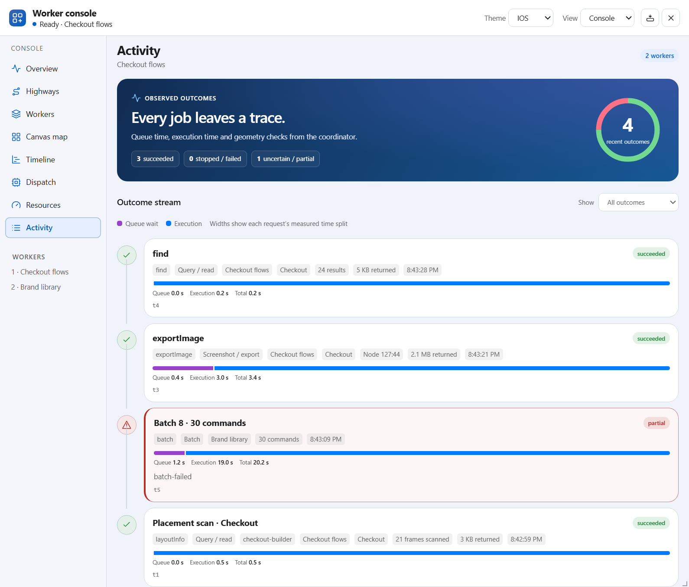

**Uncertainty alert.** When an outcome is `uncertain` or areas are held, a hero panel shows a ring with
the held count and lists the held items. **Review outcome** opens Activity and **Inspect held zones**
opens the map. Each held item has **Release after review**, which takes two clicks and is meant for
after you have looked at the canvas. Nothing is ever retried or released automatically.

### 6.4 Themes

| Theme | Treatment |
|---|---|
| **IOS** (default) | Blue-gray surfaces, 16 px corners, vivid chart colors, blue actions and a blue uncertainty hero |
| **Signal** | White workspace, near-black type, 12 px corners, inverse selection. Opaque graphite emphasis cards with a narrow clear-coat reflection on the top edge. Vivid color is reserved for data |

Both follow Figma's light/dark appearance, keyboard focus and reduced-motion preferences. Changing theme
only swaps CSS tokens. It never reconnects, clears outcomes or releases reservations.

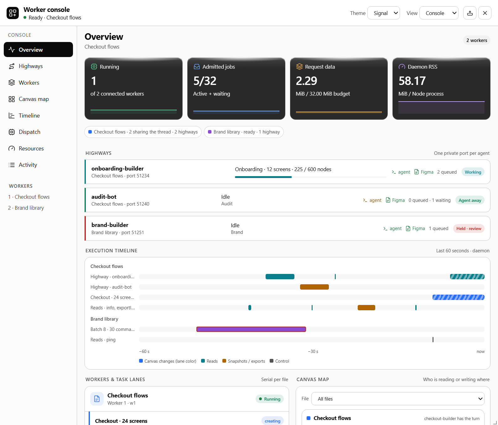

### 6.5 Telemetry contract

- Visible dashboards receive at most one snapshot per second over the authenticated paired socket. Job
  transitions publish a coalesced snapshot within 100 ms. Progress uses small request-scoped messages, at
  most 10 per second. The banner and Compact take a small summary.
- Snapshots are capped at 128 KiB. History (timeline, receipts) and sketches are trimmed, in three
  steps, before a live snapshot is ever dropped. Slow clients skip samples rather than queueing them.
- Cancellation, fencing and yield acknowledgements never wait for rendering.
- Progress bars appear only when the plugin reports a non-zero node total. Exports have no fake
  percentage or ETA. Page sketches are taken between jobs, never inside one.

---

## 7. Coordinator reference

A **worker** is one plugin instance in one Figma file, with a **file channel** (its paired control
socket). A **highway** is another channel into the same file. **Lanes** are logical streams of jobs
bound to one page.

### 7.1 Pairing and routing

- A computer pairs once, with an explicit approval prompt that expires after 2 minutes. The daemon stores
  only a **hash** of the persistent credential, separate from its admin token.
- Each plugin connection gets a fresh **worker session epoch**. Commands carry
  `workerId + sessionEpoch + fileKey`. Late replies from an old session cannot enter a new one.
- A second plugin for the same file cannot replace the first. There is one plugin instance per file.
- A highway has its own session; zone leases sent on it are fenced to that session in the plugin.

### 7.2 Lanes and fairness

- Every incoming `cmd-batch` gets its own lane automatically, with no setup step. Completed lanes leave
  the live queue, and their outcomes remain in Activity.
- **FIFO inside a lane. The least-recently-served ready lane gets the next turn.** Separate files and
  separate highways drain independently.
- On the file channel, a job keeps its turn through its yields. Give each agent a highway to share the
  thread at every pause point instead.
- Dependencies (≤ 16) name previously admitted request IDs and wait for a committed outcome. A dependency
  on held or released work fails rather than proceeding.
- Creation loads the lane's target page **without changing the visible page, selection or viewport**.

### 7.3 Zone reservations

- Each scoped creation reserves a page rectangle plus a gutter (default 24 px). Overlap is checked
  **atomically at admission**, against live, held and committed zones alike.
- In the plugin, existing artwork, effects and descendant bounds are checked again: initially, after
  font loading, at every yield and twice before commit. Overflow or collision rolls back owned nodes.
- **Automatic placement:** page-root `create` commands with fixed `w`/`h`, no `x`/`y` and the visible page
  as parent are placed automatically. The planner scans current artwork (including effect bounds, and
  skipping other zone jobs' in-flight scaffolding), picks free space with a 48 px gap and reserves it
  durably before creating. `placement: "auto"` opts positioned groups in, and `placement: "manual"`
  opts out.
- Writers without a zone are not refused because other zones exist (see [§3.4](#34-canvas-safety-zones)).
- Rollback never deletes foreign nodes. If someone reparents a foreign node into a created subtree, the
  ancestor is kept and the outcome is reported as uncertain.

### 7.4 Outcomes and recovery

```
reserved → running → committed     (occupancy retained; leaves the map after 2 minutes)
not-started | rolled-back          (occupancy released)
partial | disconnected | uncertain (area HELD; only its own channel is blocked)
```

- A metadata **journal** (`coordinator-journal.json`) is flushed and atomically replaced before dispatch.
  After a restart, interrupted work is held and committed occupancy persists.
- **Holds are scoped to the channel that produced them.** An uncertain job on a highway holds that
  highway only. An uncertain job on the file channel holds that channel only. Every held area stays
  protected against overlapping zones for everyone.
- **No timeout unlocks a held area, and nothing is replayed automatically.** Reconciliation is
  read-only: `coordinate({ op: 'reconcile', requestId })` makes the plugin check the receipt's request ID,
  fence, file, state and committed geometry. Missing or inconsistent proof stays held.
- **Release after review.** For holds that no plugin proof can settle (unscoped writes, closed
  highways), the operator can release them from the console's attention panel (two clicks). This is a
  human decision, recorded as a receipt, never a timeout. It replaces editing the journal by hand.
- Deleting the journal is not reconciliation. The daemon keeps it in memory, so editing it does nothing
  without a restart.

---

## 8. Concurrency and parallelism

| Level | Behavior |
|---|---|
| **Across files** | True parallel execution. Up to **4 file workers** run at the same time, including background tabs. Each Figma tab is its own renderer process. |
| **Within a file** | **One plugin thread, shared by turns.** Figma runs one plugin instance per file on that tab's main thread, so there is no true parallelism inside a file. The file channel and each highway have separate queues; their jobs take turns every 100 nodes and between batch items, so a short job never waits for another agent's whole batch. Only the job holding the turn runs between awaits. |
| **Highways** | Up to **16** open at once across all files, one agent each. Each has its own queue (8 jobs in the plugin, including the active one). |
| **Admission** | Up to **32 admitted jobs / 32 MiB** globally. A batch of many commands counts as one job. Filling the queue does not create executors. |
| **HTTP** | Up to 12 executing or responding requests and 8 concurrent uploads (16 MiB shared). Bodies are bounded before parsing. |
| **Inside a job** | Creation yields through the UI every 100 nodes, so cancellation, pings, other files and other highways keep moving. |

**Measured (2026-10-16, live):** four jobs were submitted together across two files and three pages
(96 roots, 4,032 nodes). The two files **overlapped execution for 7.115 s**, while the three same-file
lanes ran in sequence (before highways). All 25 acceptance checks passed. Daemon RSS stayed at
57.4–59.1 MiB.

**Guidance for producers:** give each agent its own highway. Keep a small bounded number of independent
batches in flight per agent. Prepare the next specs while Figma processes the current batch. Await
parents before children and created IDs before wiring reactions. Queue occupancy is not a throughput
target.

There is no preparation-worker pool and no automatic opening of Figma tabs. A new lane or highway does
not create a new executor: total throughput inside one file is still one thread. Highways remove
waiting and shared failure, not the thread limit.

---

## 9. Reliability and the failure contract

- **Request ownership.** Wire requests have UUIDs and belong to their receiving socket.
- **Separate clocks.** Queue time and execution time are measured separately. Execution starts on the
  plugin's busy acknowledgement. The client deadline is execution + queue + 15 s.
- **Aborts.** An HTTP abort or deadline releases the pending entry and cancels on the owning socket. New
  work waits for a terminal acknowledgement. Without one within 5 s, that connection closes. On a
  detached highway socket, the grace period starts when it resumes, and the cancellation is resent.
- **Cancellation.** A queued job is dropped instantly. An active creation checks at node boundaries and
  after async lookups and font loading. Measured active cancellations took 330–477 ms including rollback.
- **Rollback.** Each create records its nodes as Figma creates them. On failure or cancellation it
  removes them, including unparented descendants. It **never removes pre-existing nodes**. Cleanup
  failures report the remaining IDs.
- **Highway drops are not disconnects.** A highway's plugin socket that drops is detached, not closed:
  pending work keeps running, the plugin window keeps finished results, and the same plugin instance
  resumes within 60 s. A dropped agent socket likewise keeps its results in the highway outbox. A
  dropped *control* socket cancels only the file channel's own work, never a highway's.
- **Disconnects** with unresolved work set `recoveryRequired` and hold affected reservations, on that
  channel only. Reconnection or a restart alone does not unblock them.
- **Outcomes:** `not-started`, `rolled-back`, `partial`, `failed`, `uncertain`. A timeout or disconnect
  does not prove rollback. Updates to existing nodes are not transactions.
- **Retry policy:** retry only requests explicitly reported as `not-started`. Never clean up by name or
  replay whole sections after a failure. Reconcile first.
- **Typed client errors.** `fig.mjs` throws `BridgeError` with a `kind` (`daemon-down`, `batch-failed`,
  `highway-closed`, timeouts and so on) instead of collapsing everything into "Daemon unreachable".
- **Plugin-source trap.** Figma rejects plugin source containing the token `import (` anywhere,
  comments included, and the plugin window closes at once. Keep that token out of `plugin/code.js`.

---

## 10. Memory management

### What the bridge changed

| Before | After |
|---|---|
| The daemon hot-reloaded a 5,565-line client into a new temporary ES module on every change | No temporary modules are imported |
| All pages were preloaded on connection | No preload. `documentAccess: dynamic-page`, and pages load only when a lane targets them |
| Font caches lived for the session | Font caches are **operation-scoped** (and saved per job while it waits for its turn) |
| Timers, listeners and payload references could outlive a request | Released on settlement: request timers, listeners, payload references and UI yield waiters |
| Unbounded queues and bodies | Bounded pending bytes, queue jobs, request/response sizes, spec nodes and depth (see §11) |
| Diagnostics kept full payloads | Recent diagnostics retain **metadata only**. Activity receipts keep no query results or image data |
| Full dashboard re-rendered on every update | Incremental keyed DOM commits. Only the visible section renders, and hidden windows unsubscribe |
| The spatial validator walked the scene repeatedly | One combined traversal for budget, ownership and bounds. Children read once per traversal; each owned root measured once per final check. Geometry is never cached across async boundaries |
| No undo boundaries | `commitUndo` after each mutating command (an undo boundary, not a GC call) |
| Identical images re-uploaded | `image` returns a hash and identical bytes reuse it (verified across 48 repeat checks) |

Highway state is bounded too: 16 highways, an outbox of 64 results / 64 MiB per highway in the daemon
and 64 results per highway in the plugin window, 16 remembered targets and 12 page sketches per socket.

### What was measured

- **Representative soak** (40 cycles, 10 min, real screen builders, 6 images, 10 font families, Lucide
  SVGs, 120 exports): all cycles passed and 8 of 8 cancellations rolled back. Figma retained 263 MiB of
  private memory after cleanup and 2 min idle.
- **28.9-minute attribution study** (49 deployments, 168 exports, 42 distinct images): Figma retained
  521 MiB after 5 min idle, concentrated in the renderer and GPU process. Undo-boundary grouping showed no
  consistent effect.
- **Supported disposable-copy study** (19 min, 12 three-frame deployments with 7,236 spec nodes and
  1,548 SVG imports, 36 exports): **passed**. Daemon RSS 57.7 → 72.9 MiB (peak 81). 694 ping probes had
  a median of 5.6 ms and 0 errors. Figma released 720 MiB between the sampled peak and the end. The
  second identical-image pass ended **−40 MiB** from its own baseline, which is evidence against simple
  per-upload accumulation.
- During final idle, every bridge-owned collection (pending work and bytes, queue bytes, ingress,
  font cache, yield waiters, history receipts) was empty in all 21 samples.

These studies predate highways.

### What it does not claim

These changes bound **bridge-owned** state. They cannot force Figma to release native scene, image or
undo memory after node removal. Native SVG import/export, font loading and synchronous scene scans
cannot be interrupted mid-call. Process memory cannot separate live objects from allocator reservations.
Use smaller batches and exports, and split very large documents into several files.

---

## 11. Budgets and limits

| Budget | Default |
|---|---:|
| Coordinator workers / admitted jobs / request bytes | 4 / 32 / 32 MiB |
| Open highways (all files) | 16 |
| Highway resume window (agent end and plugin end) | 60 s |
| Time for a new highway's agent to connect | 30 s |
| Highway outbox in the daemon / in the plugin window | 64 results or 64 MiB / 64 results |
| Highways one plugin window can carry | 16 |
| Plugin window gives up redialing a highway after | 90 s |
| Ordinary jobs per channel in the plugin, including the active one | 8 |
| Outstanding control jobs | 4 |
| Request / command bytes | 8 MiB |
| Pending command bytes | 16 MiB + 16 KiB control reserve |
| Concurrent HTTP uploads / shared upload bytes | 8 / 16 MiB |
| HTTP executions, including responses still flushing | 12 |
| HTTP body upload deadline | 10 s |
| Response socket inactivity deadline | 15 s |
| Response bytes | 32 MiB |
| Commands per batch | 128 |
| Spec nodes per request / spec depth | 10,000 / 64 |
| Default queue deadline | 30 s |
| Default single / batch execution deadline | 60 s / 120 s |
| Maximum configurable deadline | 600 s |
| Export width × height × scale² | 32 megapixels |
| Zone job roots / dependencies | 1–64 / 16 |
| Existing-artwork inspection | Fails closed above 10,000 nodes |
| Durable receipts / lease IDs per plugin session | 512 / 512 |
| Console receipts kept / sent | 200 / 50 (timeline: the last 60 s) |
| Telemetry snapshot | 128 KiB, history trimmed first |
| Page sketch | 48 × 30 grid; pages with more than 5,000 top-level frames are not sketched |
| Finished zones on the map | 2 minutes |

---

## 12. Diagnostics

Start with `figma-ultimate doctor` ([§4.6](#46-check)). For details, `figma-ultimate diagnostics` reports:

- the local and daemon build fingerprints, Node version and settings folder
- plugin identity, the current job, queue and pending counts and bytes, uncertain work
- request counters and the last 50 request timings and outcomes
- open highways and the lobby log (`daemon.bridge.coordinator.highways`, `…lobby`)
- daemon RSS, heap, external and ArrayBuffer memory, and event-loop delay
- on Windows, each Figma process's working set and private memory

Identify the growing process before blaming the bridge for renderer memory.
`figma-ultimate highways` lists open highways; `figma-ultimate status --json` is the short form.

---

## 13. Testing and measured evidence

```bash
npm test                # stamps the build, then runs every suite
```

The tests run the **actual** plugin and UI source in mocks, and the actual daemon against a mock
plugin over HTTP/WebSocket on an ephemeral port. They use temporary token, PID and settings folders
and never touch a working daemon, Figma's settings or a document. jsdom covers DOM mutation, node
identity and focus retention, hidden panels and scheduling.

What the highway tests prove (`tests/bridge-highways.test.js`, `tests/bridge-plugin.test.js`,
`tests/bridge-ui.test.js`, `tests/bridge-integration.test.js`):

- The lobby opens a private loopback port announced only to the paired plugin; wrong tickets and wrong
  files are refused; tickets never reach telemetry.
- Two highways into one file never queue behind each other at the daemon.
- In the plugin, a short highway job finishes while a long job on another channel is still running,
  and two long jobs alternate slices. Interleaved zone jobs on one page both commit.
- An uncertain outcome holds only its own highway; the file channel and other highways keep writing;
  release after review clears it.
- An agent that drops gets its results after reconnecting; a dropped plugin socket neither cancels nor
  clouds the work; a plugin that does not come back leaves the result held on that highway only.
- Closing returns queued work as `not-started` and lets the running job finish.
- End to end through the real daemon process, `forFile()` routes through its own highway, nothing goes
  through the shared control socket, and a script that never calls `close()` still exits.

What the setup tests prove (`tests/bridge-setup.test.js`, `tests/bridge-state.test.js`,
`tests/bridge-integration.test.js`):

- A terminal approves a plugin's pairing request through the real daemon, and while it watches, no
  Windows dialog opens. A closed plugin or a full queue never leaves an approvable request behind.
- Registering in Figma's settings keeps exactly one copy of this plugin, never touches other plugins,
  refuses while Figma runs, keeps a backup and writes atomically. A clean registration is left alone.
- Commands pick one connected file by key, exact name or a unique part of the name, and refuse to guess.
- The settings folder is isolated from the original figma-cli's; an earlier installation's pairings and
  journal are moved once, never overwritten, and its token and PID are never touched.
- The same build from another install folder talks to the daemon; stale builds and other daemons are refused.

| Evidence | Result |
|---|---|
| Test suite (2026-10-20) | 189 / 189, including highways over real loopback sockets and the real daemon process |
| Package install from a tarball into a scratch prefix (2026-10-20) | `start`, `status`, `files`, `stop` work; a clone of the same build shares the daemon |
| Live coordinator acceptance, 2 files, 3 pages (2026-10-16) | **25 / 25 checks**. Collision, gutter and overflow probes left no stray nodes |
| Live navigation and layout stress (2026-10-20) | 12 / 12 jobs, 12,096 nodes, no hold or quarantine |
| Representative soak | 40 / 40 cycles, 120 exports, 8 / 8 cancellations |
| Supported memory study | Passed, 19 min |
| Highways in live Figma | **Not yet run.** Needs `figma-ultimate setup` on a machine with Figma and a run with two agents on one file |
| Automatic registration in Figma's settings | Covered by tests on recorded settings; **not yet run against a live Figma** |

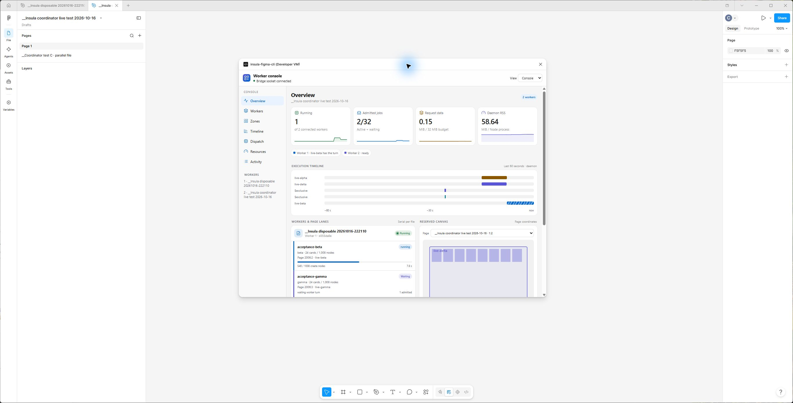

*Live run on 2026-10-16, with the earlier console: two paired files, lane `acceptance-beta` at 546 / 1,008
nodes, `gamma` waiting for its turn, and a committed reservation on the second file.*

---

## 14. Protocol versions

| Protocol | Milestone |
|---|---|
| **1** (figma-cli) | `eval` strings, one socket, no queue |
| **2** | Structured ops, one FIFO queue per plugin, out-of-queue `ping`/`info`/`cancel` (`{busy, queued, current}`), `children` op, `commitUndo` after mutations, daemon-owned keepalive, cancellation on timeout/client-gone/close, typed client errors, UUID request ownership per socket |
| **3** | File fencing (`verifyFile`, `expectedFileKey` checked in the daemon and again in the plugin), document lifecycle API, bounded diagnostics with process memory, disposable-copy memory studies, state-directory isolation |
| **4** (current) | Paired file workers (≤ 4), page lanes, fair scheduling, durable zone reservations, automatic placement, recovery holds and proof-based reconciliation, live console telemetry. Later additions under the same protocol number: highways (lobby, per-agent ports, resume, turn-taking), holds scoped per channel, operator release, page sketches, read receipts and terminal pairing approval. The build fingerprint still forces daemon and plugin to match |

Release 3.0.0 is the first one packaged on its own: the `figma-ultimate` CLI, port 3049, the
`~/.figma-cli-ultimate` settings folder and the plugin id `figma-cli-ultimate`. Stale daemons, stale
plugins and duplicate plugin instances for the same file are rejected before any work is accepted.

---

## 15. Known limits

- Native **undo** through the plugin failed its live restoration check and is disabled by default.
  **Redo** returns `unsupported` because Figma has no native redo Plugin API.
- Zone jobs cover standalone `create` only. General update/remove/move ownership and zone resize are
  not implemented. Holds can be reconciled by proof or released by the operator after review.
- Inside one file, highways share one plugin thread: they remove waiting and shared failure, not the
  thread limit. Only different files run truly in parallel.
- Closing the plugin window ends every highway into that file. The plugin's own close button asks
  first, but Figma's title-bar close button cannot be intercepted.
- The banner cannot be a borderless overlay: Figma always draws its title bar and window background.
- Reservations constrain coordinator submissions. People and other plugins can still edit the file;
  changes are detected at execution checkpoints, not prevented by a document lock.
- Conservative bounds can reject space that only *looks* empty because of clipping.
- Figma cannot open a plugin by itself: run it once in each file you want agents to work in.
- The plugin cannot be published to Figma Community (it attests file keys through the private plugin
  API). Install it from its manifest, or publish it privately inside an organization.
- Upgrading from an earlier version of this bridge: the plugin's id changed, so Figma treats it as a
  new plugin and asks to pair once more. Zones created before the upgrade cannot be confirmed by the
  plugin's receipt; release them after review if they are held.
- Apple SF fonts (variable TTFs) list in Figma for Windows but render blank. Use Inter or static OTFs.
- Automatic start is Windows-only; macOS is untested.

---

## 16. Relationship to figma-cli

figma-cli-ultimate began as a fork of [silships/figma-cli](https://github.com/silships/figma-cli)
v2.2.5 (commit `630a0dd`), whose Safe Mode plugin no longer works on Figma 126+.

- **Kept and rebuilt:** the plugin (`plugin/code.js`, `plugin/ui.html`) and the daemon
  (`src/daemon.js`), now structured-command only.
- **Added:** the coordinator, highways and pairing (`src/lib/`), the client (`bridge/fig.mjs`,
  `file-client.mjs`), the `figma-ultimate` CLI (`bin/`, `cli/`), the Windows companion, the worker
  console and every test in `tests/`.
- **Removed in 3.0.0:** the original CLI and everything that depended on evaluated code or on patching
  Figma (`render`, tokens, blocks, shadcn, extract, motion, Yolo and Browser modes, the voice plugin,
  their docs and tests). They remain in this repository's git history and in the original project.

## 17. Documentation images

The diagrams are hand-written SVG in [`docs/diagrams/`](docs/diagrams/), exported to
[`docs/images/`](docs/images/). The console screenshots are the real [`plugin/ui.html`](plugin/ui.html),
rendered with [`docs/console-stub.js`](docs/console-stub.js), which plays the plugin sandbox and the
daemon with sample data. It opens no socket and touches no daemon or document. Regenerate everything
after a UI or diagram change (needs Chrome or Edge; set `CHROME_PATH` if it is not found):

```bash
npm run docs                          # all images
node docs/render.mjs console-         # only the console screenshots
node docs/render.mjs architecture     # one diagram
```

| Image | Shows |
|---|---|
| `hero.png` | The banner at the top of this README (embeds `console-highways.png`, rendered at 1.5×) |
| `architecture.png` | Agents, lobby, highways, coordinator, plugin windows and threads |
| `base-vs-fork.png` | The base plugin's failure chain next to this fork's answers |
| `highway-sequence.png` | One highway from opening to closing, including drops |
| `turn-taking.png` | Two agents in one file: waiting vs. taking turns |
| `zone-lifecycle.png` | Zone states and how the canvas map draws them |
| `failure-isolation.png` | File-wide holds before, scoped holds after |
| `console-*.png` | Banner, compact, overview, highways, canvas map, timeline, activity, close dialog, Signal theme |

## 18. Contributing

Issues and pull requests are welcome. Before opening one:

1. `npm test` must pass. The suites run the real plugin, UI and daemon sources against mocks and never
   touch a working daemon or document.
2. After changing `plugin/ui.html` or a diagram, run `npm run docs` and commit the PNGs together with
   their sources.
3. Keep the token `import (` out of `plugin/code.js`, comments included: Figma refuses the whole
   plugin source when it sees it ([§9](#9-reliability-and-the-failure-contract)).
4. Run `figma-ultimate build` after editing runtime sources, and test against a scratch file with hot
   reload off ([§4.8](#48-after-editing-the-source)).

New behavior should come with a test that fails without it, and with numbers rather than adjectives
in the README.

## 19. License and credits

MIT. See [LICENSE](LICENSE). figma-cli-ultimate is by **Cristhian Camilo Gómez Narváez**. It started
from figma-cli by **Sil Bormüller** ([intodesignsystems.com](https://www.intodesignsystems.com/)),
whose copyright notice the license keeps.
